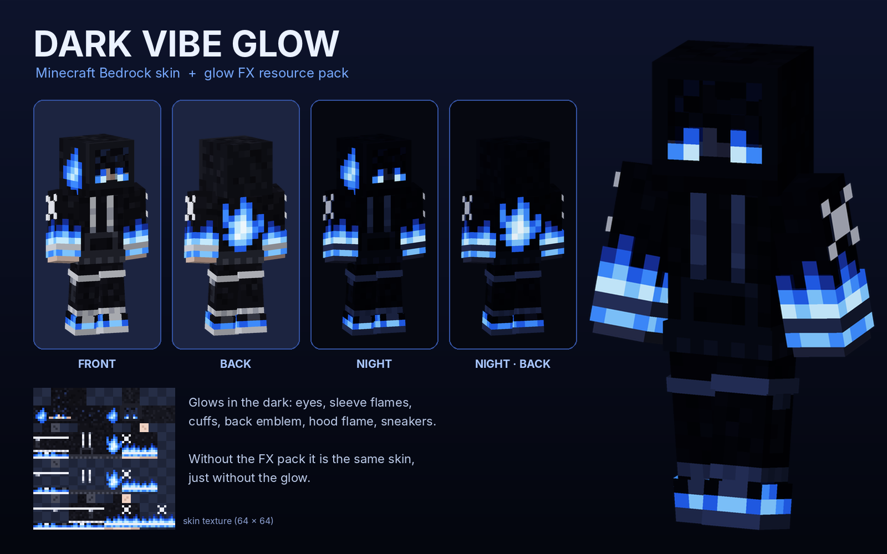

# Dark Vibe Glow: Minecraft Bedrock skin



A black hoodie skin with blue flames on the sleeves and back, a hood with a
blue flame mark, and blue-and-white sneakers. A small resource pack makes the
blue parts and the eyes **glow in the dark**.

Made for Minecraft Bedrock **1.21** on a phone, tablet or PC.

## Download

| File | What it is |
| --- | --- |
| [`DarkVibeGlow.mcaddon`](DarkVibeGlow.mcaddon) | **Use this one.** The skin and the glow pack in one file. |
| [`DarkVibeGlow_SkinPack.mcpack`](DarkVibeGlow_SkinPack.mcpack) | Only the skin pack |
| [`DarkVibeGlow_GlowFX.mcpack`](DarkVibeGlow_GlowFX.mcpack) | Only the glow resource pack |
| [`dark_vibe_glow.png`](dark_vibe_glow.png) | Only the skin image (64 × 64) |

## Install on your phone

1. **Import it.** Download `DarkVibeGlow.mcaddon` and tap it. If your phone asks
   which app to use, pick Minecraft. You should see *Successfully imported* twice.
   - If the file downloaded as `.zip`, rename it so it ends in `.mcaddon`, then tap it.
2. **Wear the skin.** Open the **Dressing Room**, go to the **Classic Skins** tab
   and find the **Dark Vibe Glow** pack with your imported/owned skins. Pick
   **Dark Vibe (Glow)** and tap **Equip**.
3. **Turn on the glow.** Go to **Settings → Global Resources → My Packs**, tap
   **Dark Vibe Glow FX** and press **Activate**.
4. **Try it out.** Play at night or go into a cave. The eyes, sleeve flames,
   cuffs, back emblem, hood flame and sneakers stay bright in the dark.

## Good to know

- **Only you see the glow.** Other players see the same skin without the glow,
  unless they have the Dark Vibe Glow FX pack turned on too.
- **No halo.** The glowing parts stay fully bright in the dark, like spider
  eyes. There is no blurry glow around them unless you use shaders.
- **Other skins.** The FX pack only changes pixels on a skin's outer layer that
  are partly see-through. Most skins don't have any, so they look the same.
  If another skin ever looks strange, turn the FX pack off.
- **Updating Minecraft.** The FX pack contains a copy of the 1.21.0 player
  file with the glow added. If you update Minecraft and the player animations
  look wrong, turn the FX pack off. The skin itself keeps working.
- **Other player add-ons.** Add-ons that also change the player can conflict
  with this one. Whichever is higher in the Global Resources list wins.

## How the glow works

Minecraft makes spider and enderman eyes glow by making those pixels almost
see-through. The game normally hides almost see-through pixels on a skin, so
every glowing part of this skin is drawn twice:

- **solid on the base layer.** This is what everyone sees.
- **almost see-through on the outer layer** (alpha 12 out of 255, or 96 for the
  softer white X marks). This is the glowing copy.

The FX pack adds one extra pass to the player that uses Minecraft's own
`spider_invisible` material. That material draws *only* the almost see-through
pixels, and draws them at full brightness. It's the same thing that shows an
invisible spider's eyes.

## Change the skin

The skin is drawn as text pixel art in [`tools/skin_art.py`](tools/skin_art.py).
Each letter is a colour, and each digit is a glowing colour. After editing,
rebuild everything (skin PNG, preview and packages) with:

```sh
python3 dark-vibe-glow-skin/tools/build.py
```

This needs Python 3 with Pillow and NumPy. To make a new version replace the
old one in Minecraft, raise the `version` numbers in both `manifest.json` files
under `src/`.
