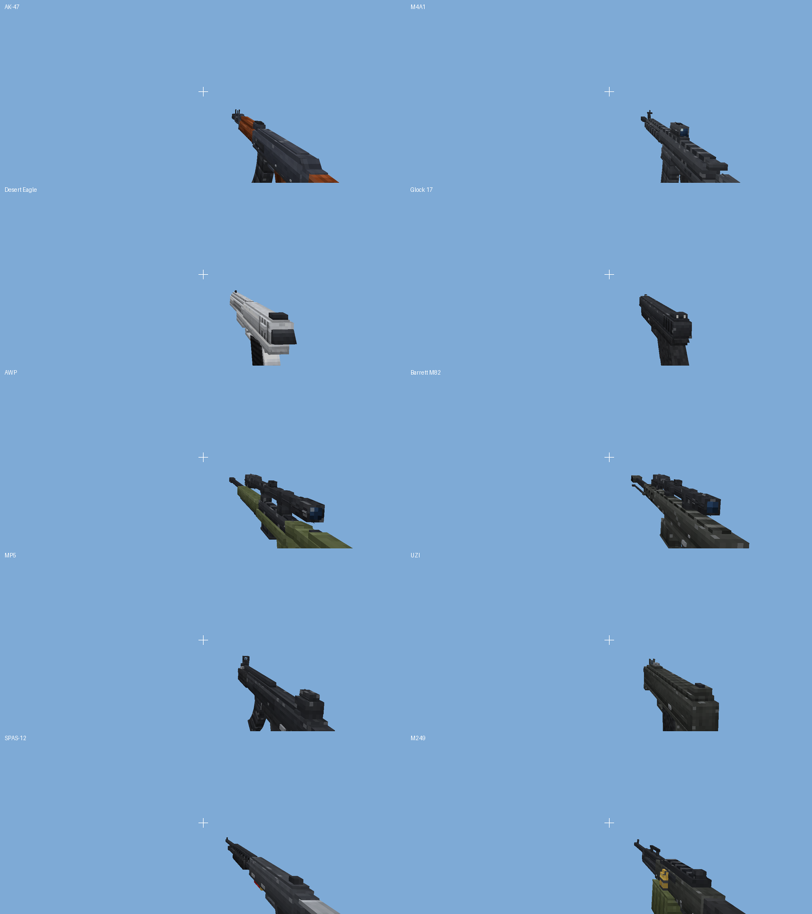
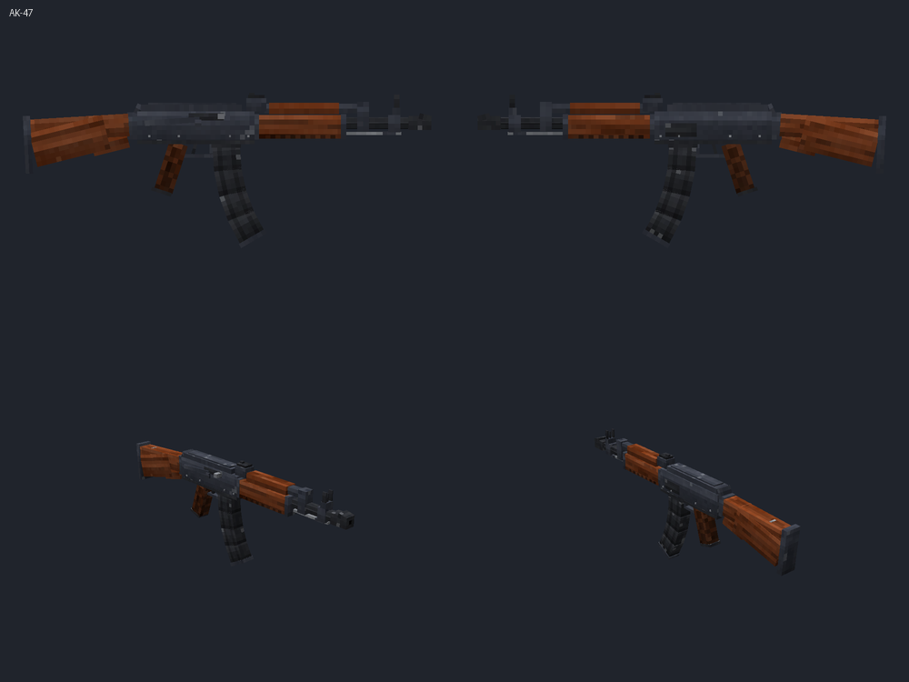
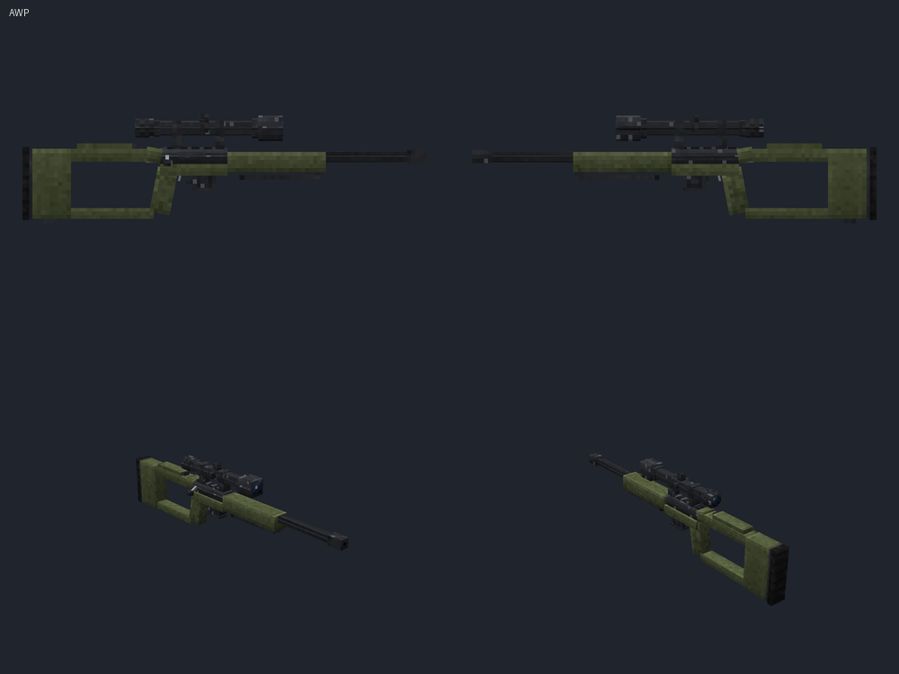
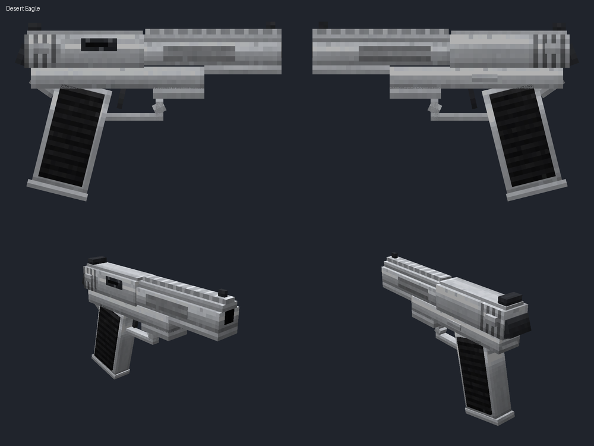

# Realistic Guns – Minecraft Bedrock Add-on (1.21.100)

Ten realistic, fully 3D guns for **Minecraft Bedrock Edition 1.21.100** (also runs on the
1.21.100.2x betas/previews and newer versions). Works on Android, iOS, Windows and consoles.
**No experimental toggles needed.**



| | | |
|---|---|---|
|  |  |  |

**One-file download:** [`dist/RealisticGuns.mcaddon`](dist/RealisticGuns.mcaddon)

---

## Install on Android (the easy way)

1. Download **`RealisticGuns.mcaddon`** onto the phone (from this repository: open the file on
   GitHub and tap **Download raw file**).
2. Open your **Downloads** (Files app) and **tap the file** → choose **Minecraft**.
   Minecraft starts and shows *"Successfully imported Realistic Guns BP"* and
   *"... RP"*.
3. Create a new world (or edit an existing one) → **Behavior Packs** → **Available** →
   select **Realistic Guns BP** → **Activate**. Minecraft asks to also apply the
   resource pack (they depend on each other) → **Yes / Activate**.
4. Play. No Experiments and no cheats are required. In Creative, open the
   **Equipment** tab → the **Guns** group (and **Gun Ammo & Magazines**).
   You can also type `/give @s rg:ak47` (needs cheats).

### If you want to zip it yourself

A `.mcaddon` is just a normal ZIP file containing the two pack folders:

```
RealisticGuns.mcaddon   (zip)
├── RealisticGuns_BP/   (manifest.json must be directly inside this folder)
└── RealisticGuns_RP/
```

* **On Android** (e.g. with *ZArchiver* or *Files by Google*): copy the folders
  `packs/RealisticGuns_BP` and `packs/RealisticGuns_RP` to the phone, select **both
  folders** → *Compress* → format **zip** → name it `RealisticGuns.zip`, then rename the file
  to `RealisticGuns.mcaddon` and tap it.
* **On PC:** `cd packs && zip -r ../RealisticGuns.mcaddon RealisticGuns_BP RealisticGuns_RP`
  (Windows: select both folders → *Send to → Compressed (zipped) folder* → rename `.zip` to
  `.mcaddon`).
* Or run `python3 tools/build.py`, which writes `dist/RealisticGuns.mcaddon` for you.

Do **not** zip the parent `packs/` folder itself – Minecraft needs each pack folder (with
its `manifest.json`) at the top level of the archive.

---

## Controls

| Action | Touch (Android/iOS) | Mouse & keyboard / controller |
|---|---|---|
| Shoot | Tap the **Fire** button (or tap the screen) | Right click / left trigger |
| Full-auto (AK-47, M4A1, MP5, UZI, M249) | Hold **Fire** | Hold right click |
| Reload | **Sneak + Fire** | Sneak + right click |
| Sniper scope (AWP, Barrett) | Hold **Sneak** to zoom, tap **Fire** to shoot | Hold Shift, right click to shoot |
| Toggle bullet block damage | `/scriptevent rg:blockdamage off` (or `on`) | same |

* The action bar shows the ammo: `AK-47  30/30  |  Mags: 3` (or *Reloading [||||....]*).
* Empty gun → *click* → it reloads automatically if you carry a matching magazine.
* Snipers reload by themselves when the magazine is empty (sneaking is used for the scope).
* Creative mode: reloading never uses up magazines.

## The guns

| Gun | Type | Damage | RPM | Mode | Mag | Reload | Range | Spread° | Recoil° |
|---|---|---|---|---|---|---|---|---|---|
| AK-47 | Assault Rifle | 7 | 600 | Auto | 30 | 2.5s | 96 | 1.6 | 1.25 |
| M4A1 (red dot) | Assault Rifle | 6 | 800 | Auto | 30 | 2.2s | 96 | 1.2 | 0.95 |
| Desert Eagle | Pistol | 12 | 240 | Semi | 7 | 1.8s | 64 | 1 | 4.5 |
| Glock 17 | Pistol | 5 | 400 | Semi | 17 | 1.4s | 56 | 1.2 | 1.8 |
| AWP (scope) | Sniper Rifle | 30 | 40 | Bolt | 5 | 3.2s | 220 | 4 / 0 scoped | 6.5 |
| Barrett M82 (scope) | Heavy Sniper | 40 | 120 | Semi | 10 | 3.8s | 260 | 5 / 0 scoped | 9 |
| MP5 | Submachine Gun | 4.5 | 800 | Auto | 30 | 2.0s | 64 | 1.9 | 0.7 |
| UZI | Submachine Gun | 4 | 600 | Auto | 32 | 1.8s | 52 | 2.6 | 0.85 |
| SPAS-12 | Shotgun | 3.5 × 8 pellets | 100 | Pump | 8 | 0.6s per shell | 32 | 5.5 | 5 |
| M249 | Light Machine Gun | 6 | 850 | Auto | 100 | 4.5s | 100 | 2.2 | 0.85 |

Damage is in half-hearts (a zombie has 20). Headshots deal ×1.4–2.0. Shotgun pellets lose
damage with distance. Every gun has its own model, texture, shoot sound, muzzle flash size,
recoil kick, camera shake and fire rate.

### Effects
* Fast bullet projectiles (`rg:bullet`) with a glowing **tracer** and a small smoke **trail**.
* **Muzzle flash** + smoke, ejected **brass casings** (red shells for the SPAS-12).
* First-person **kick animation** every shot, **pistol slides blow back**, **AWP bolt** and
  **SPAS-12 pump** cycle, **reload animation** (gun tilts, magazine drops out and back in).
* **Sniper zoom** (`/camera fov_set`), the gun hides while scoped and a precise reticle marks
  the aim point.
* Sparks + hit sounds on blocks, hit marker sound and `HEADSHOT` message on mobs/players.

### Bullets damage blocks
Bullets chip away at the block they hit. Damage adds up per block and is forgotten after
30 seconds. When it reaches the block's toughness the block breaks and **drops like normal
mining**:

| Blocks | Hits needed (example: Glock 17 / AK-47 / Barrett) |
|---|---|
| Glass, panes, ice, leaves, flowers, torches, crops | 1 |
| Dirt, sand, gravel, wool, netherrack, glowstone | 1 |
| Planks, logs, doors, fences | 3 / 2 / 1 |
| Stone, cobblestone, bricks, sandstone | 5 / 4 / 1 |
| Ores, deepslate | 6–8 / 5–6 / 1 |
| Iron/gold/diamond blocks | 12–18 / 9–13 / 2–3 |
| **Never**: bedrock, obsidian, barrier, command blocks, portals, chests, barrels, shulker boxes, furnaces, hoppers, spawners, beacons, anvils … | – |

TNT hit by a bullet is ignited. Adventure-mode players never break blocks. Turn the whole
feature off/on with `/scriptevent rg:blockdamage off` / `on` (saved in the world).

### Ammo, magazines and crafting (crafting table)

| Item | Recipe | Gives |
|---|---|---|
| 9mm Rounds | iron ingot + gunpowder + copper ingot | 16 |
| 5.56mm NATO Rounds | iron ingot + 2 gunpowder + copper ingot | 12 |
| 7.62mm Rounds | 2 iron ingots + 2 gunpowder + copper ingot | 10 |
| .50 Cal Rounds | 2 iron ingots + 3 gunpowder + copper ingot | 6 |
| 12 Gauge Shells | paper + gunpowder + copper ingot | 8 (SPAS-12 loads them directly) |
| Glock 17 Magazine | 2 × 9mm + iron ingot | 1 |
| MP5 Magazine | 3 × 9mm + iron ingot | 1 |
| UZI Magazine | 4 × 9mm + iron ingot | 1 |
| M4A1 STANAG Magazine | 3 × 5.56mm + iron ingot | 1 |
| M249 Ammo Box | 8 × 5.56mm + iron ingot | 1 |
| AK-47 Magazine | 3 × 7.62mm + iron ingot | 1 |
| AWP Magazine | 2 × 7.62mm + iron ingot | 1 |
| Desert Eagle Magazine | 2 × .50 Cal + iron ingot | 1 |
| Barrett M82 Magazine | 3 × .50 Cal + iron ingot | 1 |

Guns are crafted from iron ingots/blocks, gunpowder and a few extras (planks for the AK,
quartz for the M4 optic, gold for the Deagle, glass panes for scopes, dyes for finishes) –
see `packs/RealisticGuns_BP/recipes/rg/` or the recipe book in game.

---

## Technical details

* **Packs:** one behavior pack + one resource pack, each `manifest.json` lists the other one
  as a dependency (UUID-linked), `min_engine_version` `[1, 21, 100]`.
* **Items:** `format_version` **1.21.100** (`minecraft:icon`, `display_name`,
  `use_modifiers`, `interact_button` "Fire", `rarity`, …).
* **Creative inventory:** Bedrock has only four fixed creative *tabs* (Construction,
  Equipment, Items, Nature) – packs cannot add a new tab. The guns are therefore placed in
  their own collapsible **"Guns" group** inside the **Equipment** tab, using the official
  `item_catalog/crafting_item_catalog.json` (with a second group for ammo & magazines).
* **Script:** `scripts/main.js` uses only the **stable** `@minecraft/server` **2.0.0** module
  (stable since 1.21.90, so it runs on the 1.21.100 release *and* the 1.21.100.2x betas
  without the "Beta APIs" toggle). Item ids/stats are in the generated `scripts/gun_data.js`.
* **Models:** each gun is a hand-built Blockbench-style cube model (25–67 cubes, rotated cubes
  for grips/curved magazines) with bones `gun → recoil → body/mag/slide/bolt/pump` so parts
  can animate. Textures are 128×128 per gun at 3–6 texels per pixel (an "HD" look) with
  blued steel, anodised aluminium, walnut, polymer and chrome materials, edge wear, scratches,
  rails, vents, checkering and serrations.
* **Hold positions:** attachables bind the model to the player's right hand
  (`q.item_slot_to_bone_name(c.item_slot)`). The first and third person transforms were
  solved mathematically from the vanilla 1.21.100 player rig (first-person arm pose and the
  −24 px bound-bone offset) so every gun sits in the hand and its barrel converges on the
  crosshair; see `docs/previews/*_first_person.png` / `*_third_person.png`.
* **Client animations without extra network traffic:** the script starts item cooldown
  categories (`rg_kick`, `rg_reload`, `rg_cycle`) and the attachables read them with
  `q.cooldown_time_remaining(...)` to drive kick, reload, bolt and pump animations.
* **Damage:** bullets apply damage through `applyDamage` (projectile cause, kill credit to the
  shooter, respects armor). A small workaround keeps every hit of fast guns counting during the
  vanilla 0.5 s hurt-immunity window. PvP follows the world's `pvp` game rule.
* **Performance:** no per-tick scans of entities, at most one block raycast per pellet,
  bullets despawn after their range, particles are spawned only for nearby players,
  sounds are small mono OGG files flagged `load_on_low_memory` for low-end phones.

## Folder tree

```
realistic-guns-addon/
├── README.md
├── dist/
│   └── RealisticGuns.mcaddon        ← ready-to-import add-on (both packs)
├── docs/previews/                  ← renders of every gun (turnaround, 1st & 3rd person)
├── packs/
│   ├── RealisticGuns_BP/            ← behavior pack (generated + src/ scripts)
│   └── RealisticGuns_RP/            ← resource pack (generated)
├── src/behavior_pack/scripts/main.js ← hand-written gameplay script
├── tests/smoke/                     ← Node smoke test with a mocked @minecraft/server
└── tools/
    ├── build.py                     ← builds packs/ and dist/
    └── gunlib/                      ← model DSL, texture painter, rig solver, sounds, …
        ├── specs.py                 ← ★ all gun stats/items/recipes in one table
        ├── guns_ak.py  guns_pistol.py  guns_smg.py  guns_sniper.py  guns_heavy.py
        ├── model.py  texture.py  rig.py  hold.py  render.py  preview.py
        └── packgen.py  gamedata.py  icons.py  particles.py  sounds.py
```

<details>
<summary><b>Complete contents of the two packs</b> (click)</summary>

```
RealisticGuns_BP/
├── entities/rg/bullet.entity.json
├── item_catalog/crafting_item_catalog.json
├── items/rg/
│   ├── ammo/        ammo_50, ammo_556, ammo_762, ammo_9mm, shell_12g (.item.json)
│   ├── guns/        ak47, awp, barrett, deagle, glock17, m249, m4a1, mp5, spas12, uzi (.item.json)
│   └── magazines/   mag_ak47, mag_awp, mag_barrett, mag_deagle, mag_glock17,
│                    mag_m249, mag_m4a1, mag_mp5, mag_uzi (.item.json)
├── recipes/rg/      24 recipes (10 guns, 9 magazines, 5 ammo types)
├── scripts/
│   ├── gun_data.js
│   └── main.js
├── texts/en_US.lang, languages.json
├── manifest.json
└── pack_icon.png

RealisticGuns_RP/
├── animations/rg/          <gun>.animation.json ×10, bullet.animation.json
├── attachables/rg/         <gun>.attachable.json ×10
├── entity/rg_bullet.entity.json
├── models/entity/rg/       <gun>.geo.json ×10, bullet.geo.json
├── particles/rg/           blood, bullet_trail, impact, muzzle_flash, muzzle_smoke,
│                           reticle, shell, tracer (.particle.json)
├── render_controllers/rg.render_controllers.json
├── sounds/
│   ├── rg/                 <gun>_fire.ogg ×10, bolt, charge, dry, hitmarker, mag_in,
│   │                       mag_out, pump, shell_in (.ogg)
│   └── sound_definitions.json
├── texts/en_US.lang, languages.json
├── textures/
│   ├── rg/entity/bullet.png
│   ├── rg/guns/            <gun>.png ×10   (128×128 model textures)
│   ├── rg/items/           24 inventory icons (16×16)
│   ├── rg/particle/        muzzle_flash, reticle, shell, smoke, spark, tracer (.png)
│   └── item_texture.json
├── manifest.json
└── pack_icon.png
```
(`<gun>` = ak47, awp, barrett, deagle, glock17, m249, m4a1, mp5, spas12, uzi)
</details>

## Building from source

Requirements: Python 3.10+ with `numpy` and `Pillow`, and `ffmpeg` (with libvorbis) for the
sounds.

```
python3 tools/build.py              # → packs/ and dist/RealisticGuns.mcaddon
python3 tools/build.py --previews   # also renders docs/previews/*.png
node --import ./tests/smoke/register.mjs tests/smoke/smoke.test.mjs   # gameplay smoke test
```

To tweak a gun (damage, fire rate, magazine size, recoil, zoom, hold position, sound…), edit
its entry in `tools/gunlib/specs.py` and rebuild. To change the models edit the
`build_<gun>()` functions in `tools/gunlib/guns_*.py`.

## Troubleshooting

* **Guns don't shoot:** make sure the *behavior* pack is active on the world (the resource
  pack alone only shows the models). Turn on *Settings → Creator → Content Log GUI* to see
  script errors.
* **Hold-to-shoot on touch screens:** press and hold the **Fire** button that appears on the
  touch controls while a gun is in your hand.
* **Zoom stays stuck after a crash:** respawn or run `/camera @s fov_clear`.
* **No crosshair on mobile:** turn on the crosshair / split controls option in the touch
  control settings for precise hip fire; scoped snipers always show their own reticle.
