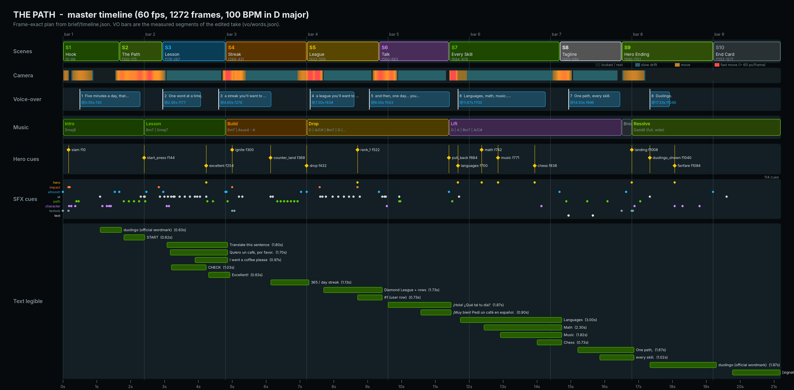
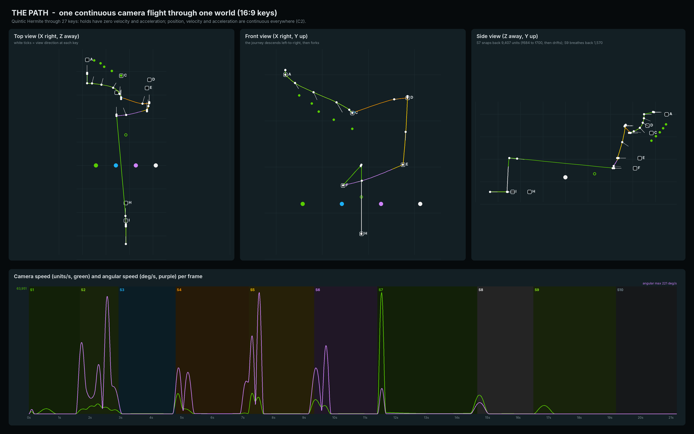

# THE PATH — Phase 1 Brief

**An unofficial Duolingo spec advertisement, built entirely in code.**
Portfolio piece only. Not affiliated with, sponsored by, or endorsed by Duolingo. Duolingo, its logo and Duo are trademarks of Duolingo, Inc.

| | |
|---|---|
| Status | **Phase 1 of 8: brief.** Waiting for approval before Phase 2 (Assets). |
| Single sources of truth | `brief/timeline.json` (every frame-timed event, the VO map, music map and SFX cue sheet) and `brief/camera_16x9.json` (world layout and camera keys). All tables below marked *generated* come from those files via `tools/plan_brief.py`, so the document and the data cannot drift apart. |
| Diagrams | `brief/diagrams/timeline.png`, `brief/diagrams/camera_path.png` |

---

## 1. Snapshot

| | |
|---|---|
| Runtime | 19.2 s film + 2.0 s end card = **21.2 s = 1,272 frames at 60 fps** (f0–f1271). Film f0–f1151, end card f1152–f1271. |
| Frame rule | `frame = round(t × 60)`. An event's frame is the first frame on which it is visible; its sound starts at `sample = frame × 800` (48 kHz / 60 fps = 800 samples per frame, so audio and picture share one integer grid). |
| Formats | 16:9 **1920×1080** (master layout) and a separately composed 9:16 **1080×1920** (portrait re-layout, not a crop). |
| Camera | One physical pinhole camera flying one continuous path through one 3D world. No cuts, no 2D slides. 37.5 mm-equivalent lens (f = 2000 px) at every station; it widens to 24 mm (f = 1300 px) only for the S7 reveal. |
| The line | One Feather Green line, drawn by one shared function, does every job: wordmark reveal → lesson path → progress bar → streak flame → league lift → voice waveform → four branches → tagline baseline → wordmark reveal. |
| Sound | ElevenLabs VO (two full takes, the best one kept), original music synthesized in code at 100 BPM in D major, and 114 sound cues. Master at −14 LUFS integrated, true peak ≤ −1.25 dBTP. |
| Stack | Python 3.13 · NumPy · Pillow (Raqm shaping) · OpenCV (to install: `opencv-python-headless`, pinned) · FFmpeg 6.1. Verified available in this environment except OpenCV, which installs from PyPI. |

---

## 2. Concept: one line, every job

In the app, Duolingo *is* a path. Here the path becomes a single thread of Feather Green light, and the camera rides it from station to station. Each station is one feature of the product, and the line does that feature's job:

| Station | The line's job | Story beat (VO) |
|---|---|---|
| A · Logo | Draws itself under `duolingo` and reveals it | *Five minutes a day, that's all it takes.* |
| B · Path | Races along five lesson nodes, lights them, presses START | |
| C · Lesson | Fills the lesson progress bar on **Excellent!** | *One word at a time,* |
| D · Streak | Curls into the streak flame, then lights the week | *a streak you'll want to keep alive,* |
| E · League | Lifts the user's row from #7 to #1 | *a league you'll want to win,* |
| F · Talk | Becomes the voice waveform in a call with Duo | *and then, one day… you just talk.* |
| G · Every skill | Splits into four branches: Languages, Math, Music, Chess | *Languages, math, music… even chess.* |
| H · Tagline | Becomes the baseline of the tagline | *One path, every skill.* |
| I · Hero | Reveals the wordmark again as Duo lands | *Duolingo.* |

The arc is built in: the sentence Duo asks you to translate in S3, *Quiero un café, por favor*, comes back in S6 when you tell Duo *Pedí un café en español* ("I ordered a coffee in Spanish"). The lesson turns into a real life moment.

---

## 3. Art direction

### 3.1 Stage and light
- **Stage:** near-black `#060A0C` void with a dim green ambient (≤ 3% green lift, never neon). Depth comes from perspective, parallax, depth of field and exponential distance fog toward the stage color. No decorative particles or random elements.
- **One light rig for the whole world:** warm-neutral key from upper-left-front, cool soft fill from the right, a faint Feather Green rim from behind. The **line is also a light**: nearby faces pick up its color (green, or orange and gold inside the flame) with a falloff radius of about 600 units. That is what makes the line feel physical rather than painted on.
- **Neon guardrails:** the line's core never clips to white (core capped at about 92% luminance, tinted `#89E219`). Bloom comes only from emissive layers, never from UI text, with halo radius ≤ 60 px and total bloom gain ≤ 0.35. One anamorphic streak in the whole film (the S4 ignition).

### 3.2 Palette tokens

| Token | Hex | Use |
|---|---|---|
| `stage` | `#060A0C` | background, fog color |
| `feather` | `#58CC02` | the line, lit nodes, Languages, wordmark (official art) |
| `feather-hi` | `#89E219` | line core tint, top-face highlights |
| `feather-lip` | `#58A700` | lips under green objects |
| `streak` | `#FF9600` | flame, streak counter |
| `gold` | `#FFC800` | flame highlight, week fills, #1 accents |
| `math` | `#1CB0F6` | Math node, diamond gem family |
| `music` | `#CE82FF` | Music node |
| `surface` | `#131F24` | dark-mode cards, phone screen, unlit lips |
| `raised` | `#37464F` | borders, unlit node tops, inactive buttons |
| `white` | `#FFFFFF` | primary text, Chess node |

Lips for orange, gold, blue, purple and white objects are derived with one rule (base × 0.82 in linear light). Their exact values will be listed in Phase 2. The one optional off-palette accent is the call's red hang-up button (`#FF4B4B`). Remove it if you want strict palette discipline.

### 3.3 Materials: the Duolingo 3D button, built as real geometry
Every object is chunky and rounded, with a **darker lip underneath**: nodes are thick discs, cards are slabs, buttons press by sinking their top face into the lip. These are true extruded meshes projected through the camera, not drop shadows. Lit nodes use `feather` top + `feather-lip` + a `feather-hi` rim. Unlit nodes use `raised` top + `surface` lip.

### 3.4 Optics and finish
- **Depth of field:** physical circle of confusion `CoC_px = f_px · A · |1/S − 1/d|` (aperture A in world units, focus S). It is applied as layered depth bins composited back to front. Text at the focus plane is always pin-sharp.
- **Motion blur:** real temporal accumulation over a 180° shutter (sub-frames centered on the frame time). The sample count adapts to screen motion: 1 sample when still, up to 16 on whips.
- **Grain:** fine monochrome grain, about 1.2% at mid-grey, seeded per frame (deterministic).
- **Vignette:** −10% at the corners. It is never applied over the wordmark at rest.

---

## 4. Typography

**SF Pro Rounded** for all Duolingo text (UI, tagline, labels), with tabular figures for every counter so digits sit in fixed cells. The wordmark is never typeset: it is always the official vector artwork.

| Role | Weight | 16:9 size | 9:16 size | Where |
|---|---|---:|---:|---|
| Tagline | Heavy | 150 px | 140 px | S8 |
| Big numeral | Heavy, tabular | 230 px | 260 px | `365` |
| Section label | Bold | 56 px | 64 px | `day streak`, course names |
| UI header | Bold | 46 px | 56 px | `Translate this sentence`, `Diamond League` |
| UI body, tiles, captions | Bold / Semibold | 40 px | 50 px | bubbles, tiles, rows, call captions |
| UI small | Semibold | 30–34 px | 38–42 px | XP, timer, day letters |
| START / CHECK | Heavy, caps, +5% tracking | 34–38 px | 44 px | buttons |
| Signature | Semibold | 56 px | 64 px | end card |
| Disclaimer | Regular, 60% white | 22 px | 26 px | end card |

Rules: text lands on the focus plane, is never motion-blurred while it is meant to be read, and stays fully legible for ≥ 0.6 s (single words) and ≥ 1.0 s (phrases). The Spanish strings are set with correct accents and inverted punctuation: *Quiero un café, por favor.* · *¡Hola! ¿Qué tal tu día?* · *¡Muy bien! Pedí un café en español.*

---

## 5. Brand and character rules

**Wordmark (official vector, Feather Green on the dark stage)**
- Rest size 700 px wide in 16:9 and 720 px in 9:16, placed on the integer pixel grid. Clear space follows Duolingo's published rule, which I will confirm in Phase 2. The working assumption, about the x-height on every side, is already respected by the layout: Duo sits 100 px above it and the line 93 px below it.
- **Pixel-exact at rest:** while the camera is locked (f66–f92 and f1044–f1151), the wordmark is not rendered through the 3D pipeline. It is composited last, after bloom, vignette and grain, straight from a raster made once from the official vector at the rest size. An automated check compares every fully opaque wordmark pixel in the RGB master against that reference and requires zero difference. While it moves, the same artwork is a textured plane in the world and gets depth of field and motion blur like everything else. The switch between the two is invisible because at rest both produce the same pixels.
- Never stretched, recolored, outlined, extruded, glowed over or animated. The reveal is a wipe tied to the line's head, so the artwork itself never changes.
- Delivery note: H.264 4:2:0 softens chroma on every edge in every video. Exactness is defined and verified on the RGB master.

**Duo (official vector artwork)**
- Animated only through its existing parts: whole-body **squash and stretch** (volume-preserving, pivot at the feet), **blink** (the eye group scales vertically to about 8% and back), **wings** (rotate about their shoulder pivots), **beak** (opens by rotating its existing shape). No new strokes, no redrawn shapes, no lighting or color grading on Duo's fills. Duo receives only optical effects (motion blur, depth of field, exposure in the final fade) and a contact shadow on the implied ground below.
- Duo is flat artwork, so the camera stays close to frontal whenever Duo is on screen.

**App UI:** rebuilt by eye in dark mode with fictional data (user *Maya*, league rivals such as *Sofía, Kenji, Ana, Lukas, Priya, Omar*, all XP values invented). No screenshots and no copied assets.

**Spec labeling:** the end card carries a one-line disclaimer. Brand source files and fonts are kept **out of git** because this repository is public (see §17).

---

## 6. Frame-exact master timeline



### 6.1 Scenes *(generated)*
<!-- GEN:scenes -->
| Scene | Name | Start | End | Frames | Length | Station |
|---|---|---|---|---|---|---|
| S1 | Hook | 0.00 s | 1.67 s | f0–f99 | 100 f (1.67 s) | A |
| S2 | The Path | 1.67 s | 2.93 s | f100–f175 | 76 f (1.27 s) | B |
| S3 | Lesson | 2.93 s | 4.80 s | f176–f287 | 112 f (1.87 s) | C |
| S4 | Streak | 4.80 s | 7.20 s | f288–f431 | 144 f (2.40 s) | D |
| S5 | League | 7.20 s | 9.33 s | f432–f559 | 128 f (2.13 s) | E |
| S6 | Talk | 9.33 s | 11.40 s | f560–f683 | 124 f (2.07 s) | F |
| S7 | Every Skill | 11.40 s | 14.67 s | f684–f879 | 196 f (3.27 s) | G |
| S8 | Tagline | 14.67 s | 16.50 s | f880–f989 | 110 f (1.83 s) | H |
| S9 | Hero Ending | 16.50 s | 19.20 s | f990–f1151 | 162 f (2.70 s) | I |
| S10 | End Card | 19.20 s | 21.20 s | f1152–f1271 | 120 f (2.00 s) | J |
<!-- /GEN:scenes -->

### 6.2 Every timed event *(generated; "given" = a time from the brief)*
<!-- GEN:events -->
| Frame | Time | Scene | Event | Spec |
|---:|---:|---|---|:---:|
| 0 | 0.000 s | S1 | **open_frame**: Frame 0 is a designed thumbnail: Duo mid-rush (~120 px tall, motion-blurred) inside converging green strands. |  |
| 10 | 0.167 s | S1 | **slam**: SLAM: Duo stops dead at ~540 px tall (half the frame height); squash peaks on the next frame; wings fling out; shake; shards; deep sub hit. | given |
| 14 | 0.233 s | S1 | **cam_ease_back**: Camera eases back from the slam pose to lock-up home A (f14 to f54, quintic ease). |  |
| 15 | 0.250 s | S1 | **slam_rebound**: Stretch peak of the rebound; settles by f24 (spring 4 Hz, damping 0.35). |  |
| 24 | 0.400 s | S1 | **strands_collapse**: The strands collapse into the single line, which ignites at the left end of the underline. |  |
| 28 | 0.467 s | S1 | **wordmark_reveal**: Line runs left to right under the wordmark; a soft wipe tied to the head x-position reveals it (f28 to f66). |  |
| 30 | 0.500 s | S1 | **vo_open**: VO: Five minutes a day, that's all it takes. | given; on the VO |
| 66 | 1.100 s | S1 | **wordmark_rest_A**: Wordmark fully revealed and pixel-exact at rest (camera still) through f92. |  |
| 70 | 1.167 s | S1 | **duo_blink**: Blink: eye group scales vertically to 8% and back (f70 to f76). |  |
| 82 | 1.367 s | S1 | **duo_hop**: Hop out: anticipation squash f78 to f82, take-off f82 with stretch and one wing flap, out of frame top-right by f94. |  |
| 100 | 1.667 s | S2 | **dive**: The line's head leaves the underline and dives into the world; camera tilts down and chases it. | given |
| 108 | 1.800 s | S2 | **node1**: Node 1 lights green (16th-note grid at 100 BPM). |  |
| 117 | 1.950 s | S2 | **node2**: Node 2 lights. |  |
| 126 | 2.100 s | S2 | **node3**: Node 3 lights. |  |
| 135 | 2.250 s | S2 | **node4**: Node 4 lights. |  |
| 144 | 2.400 s | S2 | **start_press**: The line presses START (bar 2 downbeat): node top depresses into its lip, tooltip pops; node 5 lights at f146. | given |
| 148 | 2.467 s | S2 | **phone_rise**: Phone rises out of the node (scale 0.15 to 1.0, ease-out-back), turning to face camera; screen on at f172. |  |
| 176 | 2.933 s | S3 | **push_in**: Camera pushes toward the floating phone UI (slow, continuous). | given |
| 177 | 2.950 s | S3 | **vo_one_word**: VO: One word at a time, | given; on the VO |
| 180 | 3.000 s | S3 | **title_in**: Translate this sentence (header). |  |
| 186 | 3.100 s | S3 | **duo_bubble**: Duo's speech bubble: Quiero un café, por favor. (beak talks f188 to f206; caption only, no audible line). |  |
| 192 | 3.200 s | S3 | **bank_in**: Word bank appears scrambled: coffee / I / please / a / want. |  |
| 198 | 3.300 s | S3 | **tile_I**: Tile I lifts (f196) and snaps. |  |
| 207 | 3.450 s | S3 | **tile_want**: Tile want snaps. |  |
| 216 | 3.600 s | S3 | **tile_a**: Tile a snaps. |  |
| 225 | 3.750 s | S3 | **tile_coffee**: Tile coffee snaps. |  |
| 234 | 3.900 s | S3 | **tile_please**: Tile please snaps; answer reads I want a coffee please. |  |
| 238 | 3.967 s | S3 | **check_enable**: CHECK turns from inactive grey to green. |  |
| 243 | 4.050 s | S3 | **check_press**: CHECK pressed: top face sinks into its lip (f243 to f249). |  |
| 254 | 4.233 s | S3 | **excellent**: Excellent! banner slides up + correct-answer chime; the line surges along the progress bar 70% to 100% (f254 to f266). | given |
| 276 | 4.600 s | S3 | **vo_streak**: VO: a streak you'll want to keep alive, | given; on the VO |
| 288 | 4.800 s | S4 | **leap**: Line leaps out of the phone from the progress bar's end; camera whips to follow (f288 to f322). | given |
| 290 | 4.833 s | S4 | **curl**: Line curls into the flame silhouette in one stroke; color ramps green to orange to gold. |  |
| 300 | 5.000 s | S4 | **ignite**: Flame ignites; the film's single anamorphic streak (decays over f300 to f324). | given |
| 312 | 5.200 s | S4 | **counter_in**: Counter shows 1 in fixed 3-digit cells + day streak label. |  |
| 368 | 6.133 s | S4 | **counter_land**: Odometer roll (from f318) lands on 365 with a settle bounce (f368 to f378). | given |
| 380 | 6.333 s | S4 | **day_M**: Week row day 1 fills as the line passes. |  |
| 386 | 6.433 s | S4 | **day_T**: Day 2 fills. |  |
| 392 | 6.533 s | S4 | **day_W**: Day 3 fills. |  |
| 398 | 6.633 s | S4 | **day_Th**: Day 4 fills. |  |
| 404 | 6.733 s | S4 | **day_F**: Day 5 fills. |  |
| 410 | 6.833 s | S4 | **day_Sa**: Day 6 fills. |  |
| 416 | 6.933 s | S4 | **day_Su**: Day 7 fills (accented). |  |
| 420 | 7.000 s | S4 | **crest**: Crest: the line turns downward, camera rises slightly and tilts down - anticipation before the drop. |  |
| 432 | 7.200 s | S5 | **drop**: THE DROP (bar 4 downbeat): line plunges, camera falls ~2,900 units; kick, claps and shaker enter. | given |
| 438 | 7.300 s | S5 | **vo_league**: VO: a league you'll want to win, (derived anchor; placed just after the drop so the kick never masks the onset). | on the VO |
| 455 | 7.583 s | S5 | **arrive_league**: Camera arrives at the league card (air-brake, 3 px bump). |  |
| 456 | 7.600 s | S5 | **card_in**: Diamond League card resolves; rows cascade in f460 to f472. |  |
| 466 | 7.767 s | S5 | **row_lift**: User row (#7) lifts out of the card in 3D (+90 units toward camera, 4 deg tilt). |  |
| 478 | 7.967 s | S5 | **pass_6**: Passes #6; that row slides down one slot in perspective. |  |
| 488 | 8.133 s | S5 | **pass_5**: Passes #5. |  |
| 498 | 8.300 s | S5 | **pass_4**: Passes #4. |  |
| 507 | 8.450 s | S5 | **pass_3**: Passes #3. |  |
| 515 | 8.583 s | S5 | **pass_2**: Passes #2. |  |
| 522 | 8.700 s | S5 | **rank_1**: Lands at #1 + correct-answer chime; particle burst; rank cell reads 1. | given |
| 543 | 9.050 s | S5 | **vo_and_then**: VO: and then, one day... you just talk. | given; on the VO |
| 560 | 9.333 s | S6 | **to_call**: Line flows from the card to the call UI; camera trucks left and down (f560 to f590). | given |
| 566 | 9.433 s | S6 | **call_connect**: Call connects; UI assembles (f566 to f586). |  |
| 572 | 9.533 s | S6 | **duo_caption**: Duo caption: ¡Hola! ¿Qué tal tu día?; beak talks f574 to f592. |  |
| 596 | 9.933 s | S6 | **reply_caption**: Reply appears word by word (f596, 602, 610, 616, 622, 630): ¡Muy bien! Pedí un café en español. The line becomes the voice waveform under it (f594 to f664). |  |
| 684 | 11.400 s | S7 | **pull_back**: Rapid pull-back + zoom-out (lens 2000 to 1400 px) reveals the whole path splitting into four branches; musical lift. | given |
| 690 | 11.500 s | S7 | **fork**: Path forks into four branch heads racing to the course nodes. |  |
| 700 | 11.667 s | S7 | **languages**: Languages node lights (Feather Green); eight flag tiles pop into orbit f702 to f716. | given; on the VO |
| 742 | 12.367 s | S7 | **math**: Math node lights (blue #1CB0F6) with pi. | given 12.42 s; follows the VO |
| 771 | 12.850 s | S7 | **music**: Music node lights (purple #CE82FF) with a musical note. | given 12.98 s; follows the VO |
| 836 | 13.933 s | S7 | **chess**: Chess node lights (white) and the knight hops (lands 12 frames later). | given 13.70 s; follows the VO |
| 880 | 14.667 s | S8 | **converge**: Four branch lines braid and converge; camera cranes down and pushes in to the tagline. | given |
| 892 | 14.867 s | S8 | **merge**: Strands merge into one Feather Green line. |  |
| 896 | 14.933 s | S8 | **one_path**: Line draws the baseline of One path, (f896 to f916); letters rise from it with a 2-frame stagger. | given; on the VO |
| 929 | 15.483 s | S8 | **baseline_drop**: Baseline drops one line-height to line 2 (8 frames, ending 2 frames before every skill. rises). |  |
| 939 | 15.650 s | S8 | **every_skill**: every skill. rises, starting 8 frames before the spoken word with a 1-frame letter stagger (fully risen 12 frames later); the baseline splits into four course-color strands. | on the VO |
| 965 | 16.083 s | S8 | **merge_back**: Strands merge back into Feather Green (over 16 frames, starting 26 frames after every skill. begins to rise). |  |
| 990 | 16.500 s | S9 | **breath**: Breath: music cuts to a reversed swell; camera pulls back (f990 to f1032); the baseline contracts to a point (inhale). | given |
| 998 | 16.633 s | S9 | **duo_enters**: Duo falls into frame from the top, stretched. |  |
| 1008 | 16.800 s | S9 | **landing**: Duo lands on the main impact (bar 8 downbeat): squash peak f1009, contact shadow, light shockwave; tagline (now behind) racks out of focus and fades by f1030. | given |
| 1023 | 17.050 s | S9 | **underline_run**: The point of light draws under the wordmark left to right, revealing it. |  |
| 1040 | 17.333 s | S9 | **duolingo_shown**: Wordmark fully revealed exactly on VO Duolingo. | given; on the VO |
| 1044 | 17.400 s | S9 | **wordmark_rest_I**: Wordmark pixel-exact at rest through f1151 (camera at home I since f1032). |  |
| 1084 | 18.067 s | S9 | **fanfare**: Lesson-complete fanfare; Duo's happy wing flap (two flaps, f1084 to f1112). | given |
| 1128 | 18.800 s | S9 | **hero_blink**: Final blink; idle breathing (+/-1% squash) to the end of S9. |  |
| 1152 | 19.200 s | S10 | **end_card**: Scene exposure fades to stage black (f1152 to f1176, the line fades last). | given |
| 1170 | 19.500 s | S10 | **signature_in**: Signature fades in (f1170 to f1194); spec disclaimer f1182 to f1200; hold to f1271 while the chord rings out. |  |
<!-- /GEN:events -->

---

## 7. Scene-by-scene shot list

**S1 · Hook · f0–f99 · Station A**
- **f0 is a designed thumbnail:** Duo about 120 px tall mid-rush from deep space, motion-blurred, threaded by nine converging green light strands drawn by the line function, with a soft green bloom at the vanishing point.
- f0–f9: Duo accelerates at the lens. **f10 (0.17 s) SLAM:** Duo stops dead at about 540 px tall (half the frame height). f11 squash peak (1.28 × 0.78, volume-preserving), wings flung out ±55°, 28 tiny shards skitter across the implied ground, camera shake (12 px and 0.35° roll, 85 ms decay), deep sub hit.
- f12–f24: rebound stretch, then settle; wings fold.
- f14–f54: the camera eases back into the lock-up: Duo 300 px tall above the space where the wordmark waits.
- f24: the strands collapse into one line. f28–f66: the line runs left to right under `duolingo` and reveals it with a soft wipe locked to its head. The VO enters at f30.
- f54–f92: camera locked at home A, wordmark pixel-exact from f66.
- f70 blink. f78 anticipation squash. f82 hop: Duo leaves frame top-right by f94 with one wing flap.

**S2 · The Path · f100–f175 · Station B**
- The line's head leaves the underline and **dives** toward five chunky nodes on a descending S-curve. The camera chases from above and behind (about −35° pitch), banking at most 4° into the curves.
- Nodes light on the 16th-note grid of the music: **f108, f117, f126, f135**. A white START tooltip with green caps bobs above node 5 from f112.
- **f144 (2.40 s, bar 2 downbeat): the line presses START.** The top face sinks into its lip over 6 frames, the tooltip squashes and pops, node 5 lights at f146.
- f148–f176: **a phone rises out of the node**, scaling 0.15 → 1.0 with an ease-out-back and turning upright to face the camera. The camera descends and levels. The screen powers on at f172.

**S3 · Lesson · f176–f287 · Station C**
- Phone 600 × 1240 × 60 units, dark body with a fine edge highlight. The camera pushes in slowly; the screen is about 1,170 px tall, so UI text is ≥ 40 px.
- Screen, top to bottom: progress bar (70% filled) · `Translate this sentence` · Duo with a speech bubble *Quiero un café, por favor.* · two answer lines · word bank `coffee · I · please · a · want` · `CHECK`.
- With the VO *One word at a time,* the five tiles lift into 3D (60 units toward the camera, 6° tilt) and **snap one word at a time** on the 16th grid: **f198 I · f207 want · f216 a · f225 coffee · f234 please**. Each snap is a pitched click climbing the D major scale.
- f238 CHECK turns green. f243 press.
- **f254 (4.23 s): `Excellent!`** banner + correct-answer chime. **The line surges along the progress bar from 70% to 100% (f254–f266): the bar fill is the line itself.**

**S4 · Streak · f288–f431 · Station D**
- **f288 (4.80 s):** the line leaps out of the bar's end and the camera whips right after it (motion blur, no cut).
- f290–f300: the line **draws the flame silhouette in one stroke**, its color running green → orange → gold along the stroke.
- **f300 (5.00 s) IGNITE:** the flame fills (`streak` to `gold` gradient), warm bloom, the film's **single anamorphic streak** (fades by f324).
- f312: counter `1` in three fixed tabular cells + `day streak`. f318–f368: odometer roll (units fastest, hundreds slowest). **Lands on `365` at f368 (6.13 s)** with a two-frame settle.
- f380–f416: the line exits the flame's base and runs through the week row (M T W T F S S). Each day fills gold as the head passes (6-frame spacing, ticks ascending the scale).
- f420–f431: **crest.** The line turns downward; the camera rises a touch and tilts down. Anticipation.

**S5 · League · f432–f559 · Station E**
- **f432 (7.20 s, bar 4 downbeat) THE DROP:** the line plunges about 2,900 units and the camera falls after it (about −33° pitch), levelling into the league by f460 with an air-brake bump at f455. Kick, claps and shaker enter.
- A floating **Diamond League** card (820 × 900 px slab with lip): a faceted gem badge in the blue family, seven rows (rank cell · initial avatar · name · XP). Maya is #7 with a green outline.
- f466: **Maya's row lifts out of the card in 3D** (90 units toward the camera, 4° tilt, soft shadow on the card) and climbs, riding the line up the card's left rail. It passes #6 f478 · #5 f488 · #4 f498 · #3 f507 · #2 f515. Each passed row sinks slightly and slides down one slot in perspective, and XP counts 1,690 → 2,415.
- **f522 (8.70 s): lands at #1.** The rank cell flips to `1`, gold crown accent, particle burst, the correct-answer chime again, right after the VO ends on *win*.

**S6 · Talk · f560–f683 · Station F**
- **f560 (9.33 s):** the line flows from the card into a floating video-call UI and the camera trucks left. f566: the call connects. Main tile: Duo (official art) on a soft green gradient. Picture-in-picture: Maya's initial. Header `Duo · 02:14`. Mic, camera and hang-up controls.
- f572: Duo's caption **¡Hola! ¿Qué tal tu día?** with beak animation (f574–f592).
- f596–f630: the reply builds word by word, **¡Muy bien! Pedí un café en español.**, and **the line becomes its voice waveform** (f594–f664). Its amplitude follows the sentence's eleven syllables and stress pattern (`audio/reply.py`), keyed to the word reveals.
- The VO *and then, one day… you just talk.* runs over the scene. The Spanish is captioned, not voiced, so the VO stays clear (see §19).

**S7 · Every Skill · f684–f879 · Station G**
- **f684 (11.40 s): rapid pull-back.** A minimum-jerk snap of about 8,700 units, settled by f700 while the lens widens to 24 mm, then a slow drift back (about 9,400 units in total by f866). The call card shrinks away, the **whole glowing path** appears winding down from the logo through every station, and at f690 it **forks into four branches** racing to four big course nodes that rise into view from under the lens.
- **f700 Languages** (green, eight flag tiles pop into a tilted orbit) · **f742 Math** (blue, a chunky π) · **f771 Music** (purple, a ♪ bobbing on the beat) · **f836 Chess** (white, the knight hops and lands at f848). Each lights on the frame its name is spoken in the locked VO, while the camera is nearly still (≤ 3 px/frame of motion). The brief's 12.42 / 12.98 / 13.70 s moved by −3, −8 and +14 frames: *music… even chess* needs at least 1.04 s in this read, so *chess* cannot land 0.72 s after *music* without cutting speech (see `vo/VOICE.md`). Labels sit below each node.
- Glyphs stand on the node tops as camera-facing chunky 3D shapes. Green stays the connecting light; each branch takes on its course color as it reaches its node.

**S8 · Tagline · f880–f989 · Station H**
- f866–f902: the camera cranes down and pushes in. The four branches braid (f880) and merge into one Feather Green line (f892).
- **f896 (14.93 s):** the line draws the baseline of **One path,** and the letters rise out of it with a 2-frame stagger.
- f929–f937: the baseline drops one line height. f939: **every skill.** rises, 8 frames ahead of the spoken *every* (f947) with a 1-frame letter stagger, while the baseline **splits into four strands** (green, blue, purple, white), then merges back to Feather Green over f965–f981.

**S9 · Hero Ending · f990–f1151 · Station I**
- **f990 (16.50 s) breath:** the music falls away to a reversed swell. The camera breathes back 1,570 units (f990–f1032) and the baseline contracts to a single point: an inhale.
- f998: Duo falls into frame, stretched. **f1008 (16.80 s): Duo lands on the main impact.** Squash peak f1009, contact shadow and a ring of light on the implied ground, 8 px shake. The tagline, now behind Duo, racks out of focus and fades by f1030.
- f1023–f1040: the point of light draws the underline and **reveals the wordmark, complete on the VO *Duolingo.* at f1040 (17.33 s).** The camera locks at f1032, and the wordmark is pixel-exact from f1044.
- **f1084 (18.07 s): lesson-complete fanfare** with a happy two-flap wing beat (f1084–f1112). Blink at f1128, then idle breathing in the final pose.

**S10 · End Card · f1152–f1271**
- The scene's exposure fades to stage black (f1152–f1176), with the line fading last. The signature fades in at center (f1170–f1194) and the disclaimer follows (f1182–f1200). Hold while the final D-add9 chord rings out naturally.

---

## 8. World layout and camera trajectory



**One world.** Nine stations hang in a single dark space. The journey descends left to right (logo → path → phone → flame), plunges at the drop (league), swings left (call), then the camera pulls far back so the entire route is visible at once before it forks toward the viewer into the four courses and on to the tagline and hero lock-up. Coordinates: Y up, +Z away from the opening camera.

**Home poses map exactly to the screen.** Every station has a home pose: camera 2000 units in front of the station plane, fronto-parallel, lens f = 2000 px. At a home pose **one world unit is exactly one screen pixel**, so every station layout is authored in pixels and lands where it was designed. The table of home checks below confirms that every station center projects to (960, 540) at scale 1.0000.

**Flight model.** The camera is a C2-continuous quintic Hermite spline (position, yaw, pitch, lens, focus and aperture all interpolated) through 27 keys:
- **Hold** keys have zero velocity and acceleration (the locked rest windows).
- **Pass** keys use monotone tangents, so the camera never overshoots a framing.
- Orientation is interpolated as angles, never as look-at points, so it cannot flip.
- On top of the spline sit five decaying impact shakes (zeroed before any rest window) and an auto-bank of at most 4° proportional to lateral acceleration.

*Exact positions will be fine-tuned against real renders in Phase 4. The frame timing in this document is locked.*

### 8.1 Camera keys *(generated)*
<!-- GEN:camera_keys -->
| Key | Frame | Type | Camera position | Look-at target | Lens (px) | Focus | Aperture | Purpose |
|---:|---:|---|---|---|---:|---:|---:|---|
| K00 | 0 | pass | (-3,600, 205, 7,790) | (-3,600, 190, 9,000) | 2000 | 1,210 | 40 | S1 anticipation drift toward the slam pose |
| K01 | 10 | hold | (-3,600, 190, 7,889) | (-3,600, 190, 9,000) | 2000 | 1,111 | 40 | SLAM pose: Duo = 540 px tall; impact shake is additive |
| K02 | 14 | hold | (-3,600, 190, 7,889) | (-3,600, 190, 9,000) | 2000 | 1,111 | 40 | camera recoils, then eases back |
| K03 | 54 | hold | (-3,600, 0, 7,000) | (-3,600, 0, 9,000) | 2000 | 2,000 | 24 | home A (lock-up); rest window f54 to f92 |
| K04 | 92 | hold | (-3,600, 0, 7,000) | (-3,600, 0, 9,000) | 2000 | 2,000 | 24 | end of rest; dive begins |
| K05 | 112 | pass | (-3,180, -360, 6,980) | (-2,700, -1,150, 8,850) | 2000 | 1,950 | 30 | S2 dive: tilt down, truck right |
| K06 | 128 | pass | (-2,380, -760, 6,880) | (-1,950, -1,700, 8,400) | 2000 | 1,900 | 30 | chasing the head over nodes 2-3 |
| K07 | 144 | pass | (-1,380, -1,200, 6,620) | (-760, -2,250, 7,650) | 2000 | 1,650 | 30 | START press framed from above-front |
| K08 | 162 | pass | (-830, -1,520, 6,080) | (-700, -1,780, 7,650) | 2000 | 1,700 | 32 | descending and levelling as the phone rises |
| K09 | 182 | pass | (-700, -1,660, 5,660) | (-700, -1,660, 7,650) | 2000 | 1,990 | 34 | home C reached; slow push continues |
| K10 | 282 | pass | (-700, -1,660, 5,800) | (-700, -1,660, 7,650) | 2000 | 1,850 | 34 | end of S3 push-in (150 units) |
| K11 | 302 | pass | (1,120, -1,070, 5,260) | (1,700, -1,000, 7,300) | 2000 | 2,100 | 28 | S4 whip following the leap |
| K12 | 324 | pass | (1,700, -1,000, 5,300) | (1,700, -1,000, 7,300) | 2000 | 2,000 | 28 | home D |
| K13 | 414 | pass | (1,700, -990, 5,380) | (1,700, -1,000, 7,300) | 2000 | 1,920 | 28 | slow push |
| K14 | 430 | pass | (1,700, -930, 5,370) | (1,690, -1,300, 7,300) | 2000 | 1,950 | 28 | crest: small rise, tilt down |
| K15 | 444 | pass | (1,620, -2,480, 5,050) | (1,560, -3,700, 6,900) | 2000 | 2,100 | 26 | S5 falling (pitch about -33 deg) |
| K16 | 460 | pass | (1,500, -3,900, 4,610) | (1,500, -3,900, 6,600) | 2000 | 1,990 | 26 | home E (arrival) |
| K17 | 548 | pass | (1,500, -3,900, 4,730) | (1,500, -3,900, 6,600) | 2000 | 1,870 | 26 | slow push during the climb |
| K18 | 574 | pass | (-280, -4,600, 4,300) | (-980, -4,780, 6,200) | 2000 | 2,000 | 30 | S6 move to the call |
| K19 | 592 | pass | (-1,100, -4,800, 4,210) | (-1,100, -4,800, 6,200) | 2000 | 1,990 | 30 | home F |
| K20 | 684 | hold | (-1,100, -4,800, 4,330) | (-1,100, -4,800, 6,200) | 2000 | 1,870 | 30 | push settles to zero velocity; pull-back starts |
| K21 | 700 | pass | (-330, -3,950, -4,300) | (-300, -5,500, 9,000) | 1340 | 5,600 | 22 | S7 vantage: minimum-jerk snap pull-back + zoom-out from f684, settled as Languages lights |
| K22 | 866 | pass | (-300, -3,900, -5,000) | (-300, -5,500, 9,000) | 1300 | 6,200 | 22 | slow drift back while Math, Music, Chess light |
| K23 | 902 | pass | (-300, -6,900, -5,200) | (-300, -6,900, -3,200) | 2000 | 2,000 | 26 | S8 home H after crane-down + push |
| K24 | 990 | hold | (-300, -6,900, -5,130) | (-300, -6,900, -3,200) | 2000 | 1,930 | 26 | slow push ends; the breath begins |
| K25 | 1032 | hold | (-300, -6,900, -6,700) | (-300, -6,900, -4,700) | 2000 | 2,000 | 30 | home I: breath pull-back complete; rest from here |
| K26 | 1271 | hold | (-300, -6,900, -6,700) | (-300, -6,900, -4,700) | 2000 | 2,000 | 30 | end card held at home I |
<!-- /GEN:camera_keys -->

### 8.2 Flight report per scene *(generated)*
Motion-blur samples follow from screen motion (180° shutter, one sample per ~2 px of blur, 1–16 samples).
<!-- GEN:camera_report -->
| Scene | Max speed (units/s) | Max accel (g) | Max turn (deg/s) | Max screen motion (px/frame) | Motion-blur samples (avg / max) | Max auto-bank |
|---|---:|---:|---:|---:|---:|---:|
| S1 Hook | 2,557 | 2.12 | 92 | 79 | 3.7 / 16 | 1.4° |
| S2 The Path | 4,972 | 2.24 | 214 | 193 | 15.7 / 16 | 3.7° |
| S3 Lesson | 5,398 | 9.09 | 35 | 126 | 1.6 / 16 | 4.0° |
| S4 Streak | 10,138 | 8.27 | 84 | 231 | 5.0 / 16 | 4.0° |
| S5 League | 10,368 | 11.99 | 221 | 266 | 5.1 / 16 | 4.0° |
| S6 Talk | 7,144 | 3.45 | 124 | 174 | 4.6 / 16 | 4.0° |
| S7 Every Skill | 60,906 | 70.77 | 46 | 413 | 2.5 / 16 | 4.0° |
| S8 Tagline | 9,387 | 4.90 | 20 | 106 | 3.5 / 16 | 0.0° |
| S9 Hero Ending | 4,205 | 1.89 | 0 | 34 | 2.1 / 9 | 0.0° |
| S10 End Card | 0 | 0.00 | 0 | 0 | 1.0 / 1 | 0.0° |
<!-- /GEN:camera_report -->

### 8.3 Home-pose screen mapping check *(generated)*
<!-- GEN:home_checks -->
| Station | Projected center at home pose | Scale (px per unit) |
|---|---|---:|
| A | (960.00, 540.00) | 1.0000 |
| C | (960.00, 540.00) | 1.0000 |
| D | (960.00, 540.00) | 1.0000 |
| E | (960.00, 540.00) | 1.0000 |
| F | (960.00, 540.00) | 1.0000 |
| H | (960.00, 540.00) | 1.0000 |
| I | (960.00, 540.00) | 1.0000 |
| J | (960.00, 540.00) | 1.0000 |
<!-- /GEN:home_checks -->

---

## 9. The green path: one shared function

Everything green and luminous in the film, from the hook's strands to the final underline, is drawn by **one function, `draw_green_path(frame, camera, ctx)`, in `engine/path.py`**, and nothing else may draw the line.

- **Geometry:** a single path graph made of station *legs*, each a 3D polyline in its station's local coordinates, joined end to end with arc length *s* running through the whole film: hook strands → underline A → dive → S-curve → START → phone rail → progress bar → leap → flame curl → week row → drop → league rail → call link → **waveform** → trunk → **four branches** (children at the fork) → braid → tagline baseline 1 → baseline drop → baseline 2 → breath point → underline I. Legs may deform over time (row lift, waveform displacement, baseline drop, contraction to a point) but stay one connected graph.
- **Timing:** the head position `s_head(frame)` is keyed directly to timeline events. The head reaches node *i* on its light frame, the START node at f144, the bar's end at f266, closes the flame at f300, reaches each weekday on its frame, and reaches each branch tip on its course's spoken frame. A visible window `[s_tail, s_head]` with per-leg trail rules keeps lit work lit: the bar stays full, the underline stays under the wordmark.
- **Style, all parameterized by s and t:** perspective-correct core width (6 px at a home pose), two-lobe glow (18 px and 60 px), a small head spark, and a color ramp along s (Feather Green by default, orange and gold through the flame, course colors on the branches and in the tagline split). Brightness breathes ±4% with the music.
- **Rendering:** emissive layer plus light contribution to nearby geometry; depth-binned for depth of field; called once per motion-blur sub-frame, so the line's motion blur is real.

---

## 10. Voice-over plan

- **Engine:** ElevenLabs `eleven_v4` (this workspace's default) through the connected ElevenLabs tools. **Two full takes of the entire script** (one generation request with two variations), same voice, natural speed, punctuation-driven pauses, no direction tags.
- **Voice shortlist** (found in this workspace; previews in the ElevenLabs flow when we generate):
  1. **Mira, Bright & Friendly Narrator** (American, young; my first choice: warm, clear, upbeat without being shouty)
  2. Kristen, upbeat social media influencer (more creator energy)
  3. Lauren B, Gen-Z Influencer, Feels Real (most casual)
- **Choosing the take:**
  - transcribe both with ElevenLabs Scribe (word timestamps) and require an exact word match to the script;
  - check pronunciation of *Duolingo* and *chess*;
  - check for clicks and artifacts (spectral discontinuity scan) and for clean pauses;
  - prefer the take whose natural pauses need the least adjustment to hit the anchors.
- **Edit rules:**
  - Cut **only inside the take's own pauses**. Never time-stretch or pitch-shift speech.
  - Every anchor in the brief is hit by moving whole phrases at their pauses. The course words inside segment 6 (*Languages,* · *math,* · *music…* · *even chess.*) move as close to their times as the take's pauses allow; the animation absorbs what is left.
  - An edited pause keeps the previous word's tail and the next word's lead-in; the middle becomes the take's own room tone, crossfaded 10 ms at zero crossings. Pauses shrink to no less than 45 % of their natural length or their punctuation's minimum (comma 0.12 s, ellipsis 0.30 s).
  - Word timings are verified to ±1 frame. The animation is then **locked to the recording**: `timeline.json` is rewritten with measured word frames, and any event tied to a word follows it.
- **Waveform source (S6):** planned as a one-off Spanish control line in the same voice. ElevenLabs refused that request (the account's free tier was disabled for "unusual activity" after both takes and both transcriptions were done), so the waveform follows the sentence's own syllables and stress instead (`audio/reply.py`). It was never going to be heard, so the mix is unaffected.
- **Result (Phase 3): take B**, edited at its own pauses and locked to the timeline. Full report: [`vo/VOICE.md`](vo/VOICE.md).

### 10.1 Placement map *(generated; * = derived anchor, not given in the brief)*
<!-- GEN:vo -->
| # | Segment (cut only at the take's own pauses) | Anchor | Frame | Sample @48 kHz | Must end before | Measured end |
|---:|---|---:|---:|---:|---:|---:|
| 1 | Five minutes a day, that's all it takes. | 0.50 s | 30 | 24,000 | 2.90 s | 2.28 s |
| 2 | One word at a time, | 2.95 s | 177 | 141,600 | 4.20 s | 4.07 s |
| 3 | a streak you'll want to keep alive, | 4.60 s | 276 | 220,800 | 7.15 s | 6.16 s |
| 4 | a league you'll want to win, | 7.30 s * | 438 | 350,400 | 8.68 s | 8.59 s |
| 5 | and then, one day... you just talk. | 9.05 s | 543 | 434,400 | 11.60 s | 11.42 s |
| 6 | Languages, math, music... even chess. | 11.67 s | 700 | 560,000 | 14.85 s | 14.25 s |
| 7 | One path, every skill. | 14.93 s | 896 | 716,800 | 16.45 s | 16.45 s |
| 8 | Duolingo. | 17.33 s | 1040 | 832,000 | 18.05 s | 17.92 s |
<!-- /GEN:vo -->

---

## 11. Music: original, synthesized in code

**100 BPM · D major · 4/4.** One beat = 36 frames and one bar = 144 frames, so the brief's big moments land on downbeats: START (2.40 s, bar 2), the drop (7.20 s, bar 4) and the landing (16.80 s, bar 8).

| Section | Frames | Harmony | Arrangement |
|---|---|---|---|
| Intro | f0–f143 | Dmaj9 | Marimba riff, mallet plucks, felt keys, rounded sub-bass, **all from frame 0** |
| Lesson | f144–f287 | Bm7 · Gmaj7 | Same palette; node ticks and tile snaps are pitched to the scale so they play as part of the music |
| Build | f288–f431 | Em7 · Asus4 → A | Warmer keys, filtered riser, an eighth-note rest just before the drop |
| **Drop** | f432–f683 | D · A/C# · Bm7 · G | **Kick, claps on 2 and 4, swung 16th shaker**, side-chained sub, the marimba riff in full |
| **Lift** | f684–f989 | G · A · Bm7 · A/C# | At the fork: octave-up bell arpeggio, open hats, pad swell. Course hits pitched D6 · F#6 · A6 · D7 |
| **Breath** | f990–f1007 | — | Everything cut except a **reversed swell** of the coming chord |
| **Resolve** | f1008–f1271 | D add9 | **Full chord + low impact at f1008**, ringing naturally under the fanfare and the whole end card |

**Instruments, all synthesized deterministically in NumPy at 48 kHz:**
- Marimba: modal synthesis with partials at 1 / 3.93 / 9.2 and a mallet transient.
- Plucks: bell-like FM.
- Felt keys: inharmonic additive synthesis, low-passed, with a felt thump.
- Sub: sine with soft second-harmonic saturation.
- Kick: pitch-swept sine with a click.
- Claps: layered band-passed noise bursts.
- Shaker: swung noise grains.
- Space: FFT convolution reverb with a synthesized stereo impulse response.

The music dips 6 dB under each hero cue (30 ms attack, 400 ms release).

---

## 12. Sound design: 114 cues

**Every visible movement has a sound.** All cues are frame-placed from `timeline.json`.

**Approach (pending your answer in §21):** synthesize every cue procedurally:
- whooshes: filtered noise with band sweeps, Doppler and panning that follows screen position;
- UI clicks and pops: tuned blips with resonant bodies;
- impacts: sine thump, noise burst and sub;
- feathers: amplitude-modulated noise grains;
- shimmers: granular.

Procedural cues are deterministic, license-clean and **in key** with the score. If you supply an SFX library, each cue maps to a library file instead.

**Hero cues:**

| Frame | Cue |
|---|---|
| f10 | Slam + deep sub hit |
| f254 | **Correct-answer chime** |
| f522 | **Correct-answer chime** |
| f1008 | Landing impact |
| f1084 | **Lesson-complete fanfare** |

All five fall in gaps in the VO, so none of them masks a word.

### 12.1 Cue sheet *(generated)*
<!-- GEN:sfx -->
| # | Frame | Time | Scene | Cue | Layer | Sound |
|---:|---:|---:|---|---|---|---|
| 1 | 0 | 0.000 | S1 | `rush_in` | whoosh | Air-rush with Doppler as Duo flies in from depth (10 frames). |
| 2 | 0 | 0.000 | S1 | `strand_shimmer` | texture | High airy shimmer for the streaking strands, wide stereo. |
| 3 | 10 | 0.167 | S1 | `slam_impact` | impact | Body thump + transient crack. |
| 4 | 10 | 0.167 | S1 | `sub_hit` | impact | 38 Hz sine drop, 0.6 s (deep sub hit). |
| 5 | 10 | 0.167 | S1 | `shards` | texture | Glassy micro-tinkles, 14 grains over 22 frames. |
| 6 | 11 | 0.183 | S1 | `wing_fling` | character | Feather whoosh as the wings fling out. |
| 7 | 12 | 0.200 | S1 | `shake_rumble` | impact | Low rumble tail with the camera shake. |
| 8 | 15 | 0.250 | S1 | `rebound` | character | Soft rubbery rebound, pitched D. |
| 9 | 22 | 0.367 | S1 | `wing_fold` | character | Soft feather rustle. |
| 10 | 24 | 0.400 | S1 | `strands_collapse` | path | Zip as the strands snap into one line. |
| 11 | 28 | 0.467 | S1 | `line_run_A` | path | Light-run shimmer panned left to right (38 frames). |
| 12 | 66 | 1.100 | S1 | `wordmark_settle_A` | ui | Soft glassy ting as the reveal completes. |
| 13 | 70 | 1.167 | S1 | `blink_A` | character | Tiny tick. |
| 14 | 78 | 1.300 | S1 | `hop_anticipation` | character | Soft squash creak. |
| 15 | 82 | 1.367 | S1 | `hop_jump` | character | Upward whoop. |
| 16 | 85 | 1.417 | S1 | `hop_flap` | character | Single wing-flap flutter. |
| 17 | 92 | 1.533 | S1 | `duo_exit` | whoosh | Whoosh off-frame, panned right. |
| 18 | 100 | 1.667 | S2 | `dive_whoosh` | whoosh | Big downward sweep for the dive. |
| 19 | 108 | 1.800 | S2 | `node1` | path | Pitched pluck-tick D5. |
| 20 | 117 | 1.950 | S2 | `node2` | path | Pitched pluck-tick E5. |
| 21 | 126 | 2.100 | S2 | `node3` | path | Pitched pluck-tick F#5. |
| 22 | 135 | 2.250 | S2 | `node4` | path | Pitched pluck-tick A5. |
| 23 | 138 | 2.300 | S2 | `start_wobble` | ui | START tooltip wiggle squeak. |
| 24 | 144 | 2.400 | S2 | `start_press` | ui | Chunky 3D button click (thock). |
| 25 | 145 | 2.417 | S2 | `start_pop` | ui | Tooltip pop. |
| 26 | 146 | 2.433 | S2 | `node5` | path | Bright pluck B5 + sparkle. |
| 27 | 148 | 2.467 | S2 | `phone_rise` | whoosh | Rising riser-whoosh (0.45 s). |
| 28 | 170 | 2.833 | S2 | `phone_settle` | impact | Soft settle thud. |
| 29 | 172 | 2.867 | S2 | `screen_on` | ui | UI glow-on blip. |
| 30 | 178 | 2.967 | S3 | `push_air` | whoosh | Soft air on the push-in. |
| 31 | 180 | 3.000 | S3 | `title_in` | ui | UI swipe-in. |
| 32 | 184 | 3.067 | S3 | `duo_pop` | character | Pop as Duo appears in the lesson. |
| 33 | 186 | 3.100 | S3 | `bubble_pop` | ui | Speech-bubble pop. |
| 34 | 188 | 3.133 | S3 | `duo_chatter` | character | Three tiny syllable blips with the beak (very low; VO stays clear). |
| 35 | 192 | 3.200 | S3 | `bank_in` | ui | Word-bank cascade (5 micro-ticks). |
| 36 | 196 | 3.267 | S3 | `tile_lift` | ui | Small whoosh-up shared by each tile lift (re-triggered 2 frames before every snap). |
| 37 | 198 | 3.300 | S3 | `snap_I` | ui | Snap click pitched D. |
| 38 | 207 | 3.450 | S3 | `snap_want` | ui | Snap click pitched E. |
| 39 | 216 | 3.600 | S3 | `snap_a` | ui | Snap click pitched F#. |
| 40 | 225 | 3.750 | S3 | `snap_coffee` | ui | Snap click pitched A. |
| 41 | 234 | 3.900 | S3 | `snap_please` | ui | Snap click pitched B. |
| 42 | 238 | 3.967 | S3 | `check_enable` | ui | Soft state blip. |
| 43 | 243 | 4.050 | S3 | `check_press` | ui | Button press thock. |
| 44 | 254 | 4.233 | S3 | `correct_chime_1` | hero | HERO: correct-answer chime. |
| 45 | 254 | 4.233 | S3 | `banner_slide` | ui | Excellent! banner swipe-up. |
| 46 | 256 | 4.267 | S3 | `progress_surge` | path | Rising shimmer as the light fills the bar. |
| 47 | 266 | 4.433 | S3 | `progress_full` | path | Sparkle ping when the bar is full. |
| 48 | 288 | 4.800 | S4 | `line_leap` | whoosh | Whoosh up-right as the line leaps out. |
| 49 | 290 | 4.833 | S4 | `camera_whip` | whoosh | Air whip. |
| 50 | 292 | 4.867 | S4 | `curl_swirl` | path | Spiral swirl, stereo rotation. |
| 51 | 300 | 5.000 | S4 | `ignite` | impact | Fire whoomp. |
| 52 | 300 | 5.000 | S4 | `anamorphic_shimmer` | texture | Shimmering horizontal sweep with the streak. |
| 53 | 304 | 5.067 | S4 | `flame_bed` | texture | Soft crackle bed (low) until f432. |
| 54 | 312 | 5.200 | S4 | `counter_pop` | ui | Counter appears. |
| 55 | 318 | 5.300 | S4 | `counter_roll` | ui | Odometer tick train, accelerating then decelerating, until f368. |
| 56 | 368 | 6.133 | S4 | `counter_land` | ui | 365 lands: ding + soft thunk. |
| 57 | 372 | 6.200 | S4 | `label_pop` | ui | day streak label pulse. |
| 58 | 380 | 6.333 | S4 | `day_1` | path | Pitched tick D. |
| 59 | 386 | 6.433 | S4 | `day_2` | path | Pitched tick E. |
| 60 | 392 | 6.533 | S4 | `day_3` | path | Pitched tick F#. |
| 61 | 398 | 6.633 | S4 | `day_4` | path | Pitched tick G. |
| 62 | 404 | 6.733 | S4 | `day_5` | path | Pitched tick A. |
| 63 | 410 | 6.833 | S4 | `day_6` | path | Pitched tick B. |
| 64 | 416 | 6.933 | S4 | `day_7` | path | Pitched tick D' + sparkle. |
| 65 | 422 | 7.033 | S4 | `predrop_suck` | whoosh | Reverse whoosh sucking into the drop. |
| 66 | 432 | 7.200 | S5 | `drop_whoosh` | whoosh | Big downward plunge. |
| 67 | 455 | 7.583 | S5 | `arrive_brake` | impact | Air-brake thump on arrival. |
| 68 | 456 | 7.600 | S5 | `card_reveal` | ui | UI swish as the card resolves. |
| 69 | 460 | 7.667 | S5 | `rows_cascade` | ui | Seven soft row ticks. |
| 70 | 466 | 7.767 | S5 | `row_lift` | ui | Whoosh-up + glassy lift. |
| 71 | 478 | 7.967 | S5 | `pass_6` | ui | Tick + row slide. |
| 72 | 488 | 8.133 | S5 | `pass_5` | ui | Tick + row slide. |
| 73 | 498 | 8.300 | S5 | `pass_4` | ui | Tick + row slide. |
| 74 | 507 | 8.450 | S5 | `pass_3` | ui | Tick + row slide. |
| 75 | 515 | 8.583 | S5 | `pass_2` | ui | Tick + row slide. |
| 76 | 522 | 8.700 | S5 | `correct_chime_2` | hero | HERO: correct-answer chime. |
| 77 | 522 | 8.700 | S5 | `rank1_land` | impact | Soft thump + sparkle burst. |
| 78 | 526 | 8.767 | S5 | `xp_settle` | ui | XP counter settle tick. |
| 79 | 560 | 9.333 | S6 | `to_call_whoosh` | whoosh | Transition whoosh. |
| 80 | 566 | 9.433 | S6 | `call_connect` | ui | Two-tone call-connect chime. |
| 81 | 570 | 9.500 | S6 | `tile_popin` | ui | Video tile pop-in. |
| 82 | 572 | 9.533 | S6 | `duo_bubble` | ui | Caption bubble pop. |
| 83 | 574 | 9.567 | S6 | `duo_talk` | character | Beak blips (very low; VO stays clear). |
| 84 | 596 | 9.933 | S6 | `user_bubble` | ui | Caption pop. |
| 85 | 596 | 9.933 | S6 | `wave_on` | path | Waveform activation shimmer. |
| 86 | 598 | 9.967 | S6 | `wave_texture` | path | Band-limited voice-like texture following the waveform envelope (very low) until f664. |
| 87 | 684 | 11.400 | S7 | `pullback_whoosh` | whoosh | Huge reverse-air whoosh + sub swell. |
| 88 | 690 | 11.500 | S7 | `fork_zing` | path | Four zips panned left to right. |
| 89 | 700 | 11.667 | S7 | `languages_light` | hero | Node light chime D6 + pop. |
| 90 | 702 | 11.700 | S7 | `flag_pops` | ui | Eight staggered flag pops (f702 to f716). |
| 91 | 742 | 12.367 | S7 | `math_light` | hero | Node light chime F#6 + pi pop. |
| 92 | 771 | 12.850 | S7 | `music_light` | hero | Node light chime A6 + note pop. |
| 93 | 836 | 13.933 | S7 | `chess_light` | hero | Node light chime D7 + wooden knock. |
| 94 | 848 | 14.133 | S7 | `knight_land` | character | Wooden tock as the knight lands. |
| 95 | 880 | 14.667 | S8 | `converge_whoosh` | whoosh | Four strands zipping together. |
| 96 | 892 | 14.867 | S8 | `merge_zip` | path | Merge zip. |
| 97 | 896 | 14.933 | S8 | `line1_reveal` | text | Soft upward swell for One path, |
| 98 | 929 | 15.483 | S8 | `baseline_drop` | path | Soft whoop down. |
| 99 | 939 | 15.650 | S8 | `line2_split` | text | Four-voice stereo shimmer for every skill. and the color split. |
| 100 | 965 | 16.083 | S8 | `merge_back` | path | Glassy resolve as the strands merge. |
| 101 | 990 | 16.500 | S9 | `breath_inhale` | texture | Air inhale under the reversed swell. |
| 102 | 998 | 16.633 | S9 | `duo_fall` | whoosh | Descending whistle-whoosh. |
| 103 | 1008 | 16.800 | S9 | `landing_impact` | hero | HERO: landing hit, locked with the music impact. |
| 104 | 1008 | 16.800 | S9 | `shockwave` | texture | Airy burst for the light shockwave. |
| 105 | 1010 | 16.833 | S9 | `tagline_dissolve` | texture | Granular sparkle out. |
| 106 | 1013 | 16.883 | S9 | `landing_rebound` | character | Subtle rebound. |
| 107 | 1023 | 17.050 | S9 | `line_run_B` | path | Shimmer sweep left to right. |
| 108 | 1040 | 17.333 | S9 | `wordmark_settle_B` | ui | Soft ting on Duolingo. |
| 109 | 1084 | 18.067 | S9 | `lesson_complete_fanfare` | hero | HERO: lesson-complete fanfare (D major). |
| 110 | 1084 | 18.067 | S9 | `wing_flap_1` | character | Flutter. |
| 111 | 1098 | 18.300 | S9 | `wing_flap_2` | character | Flutter. |
| 112 | 1128 | 18.800 | S9 | `blink_I` | character | Tick. |
| 113 | 1152 | 19.200 | S10 | `dim_whoosh` | whoosh | Soft low whoosh down into the end card. |
| 114 | 1176 | 19.600 | S10 | `signature_reveal` | ui | Soft glass tone. |
<!-- /GEN:sfx -->

---

## 13. Mix and loudness

| Target | Spec | How it is verified |
|---|---|---|
| Voice | ≈ −16 LUFS integrated (VO stem) | ITU-R BS.1770-4 meter in NumPy, cross-checked with FFmpeg `ebur128` |
| Music under voice | **≥ 12 dB below every spoken word** | Per-word K-weighted level of VO vs. music over each word's span (from Scribe timings); automatic sidechain ducking drives it; report lists the worst word |
| Hero cues | Music dips 6 dB under each | Envelope check at f254, f522, f1084 |
| Master | **−14 LUFS integrated** (±0.5) | BS.1770-4 integrated, gated |
| True peak | **≤ −1.25 dBTP** | 4× oversampled true-peak limiter (ceiling −1.3 dBTP); verified by 4× oversampling meter + FFmpeg |
| Intelligibility | VO never overlapped by a hero cue; SFX ≥ 8 dB under VO during words | Same per-word report |

Bus chain: VO (gentle compression) + music (sidechained to VO, with hero dips) + SFX → gentle 2:1 glue → gain to −14 LUFS → true-peak limiter.

---

## 14. Technical implementation

**Engine layout (Phase 4):**
```
the-path/
  engine/
    config.py        format profiles (16:9, 9:16), palette, type scale
    timeline.py      loads timeline.json; frame/time helpers; easing library
    camera.py        pinhole camera (K, R, t), quintic flight, shakes, auto-bank, home poses
    path.py          draw_green_path(): the ONE line function (graph, timing, style, render)
    geometry.py      extruded rounded slabs/discs with lips, planes, text quads
    raster.py        supersampled AA fills, homography warps, premultiplied linear-light compositing
    svg.py           minimal SVG reader (paths, groups, transforms) -> polygons, part-aware
    duo.py           Duo rig on the official artwork: squash/stretch, blink, wings, beak
    text.py          SF Pro Rounded layout via Pillow + Raqm, tabular figures, fixed digit cells
    lighting.py      world light rig + line-as-light contribution
    post.py          layered DOF, motion-blur accumulation, bloom, anamorphic streak, vignette, grain
    scenes/          s01_hook.py ... s10_endcard.py (station content in the one world)
    render.py        multiprocess frame renderer, deterministic seeds, PNG/FFV1 masters
  audio/  synth.py music.py sfx.py vo_edit.py mix.py loudness.py
  tools/  plan_brief.py, qa_contact_sheets.py, qa_pixel_exact.py, qa_sync.py, qa_loudness.py
```

**Frame pipeline:**
1. Evaluate the camera and all animation at the sub-frame time.
2. Build the scene: 3D meshes, planar UI and text layers (textures rendered at 2× and mip-mapped), Duo, and the line.
3. Project everything through the camera.
4. Shade with the world light rig plus the line's light.
5. Route into depth bins and apply depth of field.
6. Accumulate the motion-blur sub-frames.
7. Bloom from emissive layers, then tone-map with a soft highlight shoulder.
8. Vignette, then grain.
9. Composite the pixel-exact wordmark at rest.
10. Encode to sRGB 8-bit.

**Determinism:** every random value comes from a generator seeded by `(element, frame)`. A frame is a pure function of its index and the format, so re-renders are bit-identical, and the QA step checks this by hashing re-rendered frames.

**Performance budget** (4 CPU cores and 15 GB RAM here):
- About 1–1.5 s per single-sample 1080p frame per core.
- Adaptive motion blur averages about 4–6 samples per frame.
- Final renders: about 45–90 min per format.
- Previews: 960 × 540 with capped samples, plus per-scene contact sheets that I inspect frame by frame.

**Repository hygiene:** source, JSON, small audio and docs are committed at the end of every phase (the cloud container is temporary). Frames, masters, official brand files and font files are git-ignored.

---

## 15. 9:16 portrait re-layout (Phase 7)

Same world, same path topology, same frame timing, with **new home poses and portrait station layouts**. The lens stays f = 2000 px, which on a 1080-wide frame gives a 30° × 51° field of view. Critical text stays out of the top 220 px and bottom 380 px (social UI overlays) with 60 px side margins.

| Station | Portrait composition |
|---|---|
| A / I lock-up | Stacked, wordmark 720 px wide, Duo 360 px |
| B path | The S-curve reads vertically; the camera follows it down |
| C lesson | The phone fills the frame; UI type about 1.25× the 16:9 sizes |
| D streak | Flame top, `365` and label center, week row bottom |
| E league | Card full-width, 120 px rows; the climb travels further |
| F call | Duo tile top half; captions and waveform bottom half |
| G courses | 2 × 2 grid of course nodes with the journey rising behind them |
| H tagline | Two lines at 140 px |
| J end card | Signature 64 px, disclaimer 26 px |

---

## 16. Output specifications

| | 16:9 | 9:16 |
|---|---|---|
| File | `ThePath_SPEC_16x9_1920x1080_60p.mp4` | `ThePath_SPEC_9x16_1080x1920_60p.mp4` |
| Video | H.264 High, yuv420p, BT.709 tagged, 60/1 CFR, 1,272 frames, 2-pass about 18 Mb/s (about 48 MB, under GitHub's 50 MB soft limit) | same |
| Audio | AAC-LC 320 kb/s, 48 kHz stereo, 21.200 s = 1,017,600 samples | same |
| Masters (kept in session, not committed) | Lossless RGB frames / FFV1 (reference for pixel-exact checks) | same |
| Audio masters | 48 kHz / 24-bit WAV mix + stems (VO, music, SFX) | — |

**Final QA (Phase 8), automated with a written report:**
- ffprobe: frame count, fps, duration, resolution, codec and color tags.
- Full decode test.
- LUFS and true peak.
- Hero-cue sync by onset detection (±1 frame).
- Per-word music margin.
- Pixel-exact wordmark check.
- Determinism hashes.
- Contact sheets.

---

## 17. Asset requirements (Phase 2 checklist)

| # | Asset | Source | Notes |
|---|---|---|---|
| 1 | Official Duolingo **wordmark** (vector) + clear-space rule | Duolingo's brand site (reachable from this environment) or your files | Git-ignored (public repo) |
| 2 | Official **Duo** vector artwork, front-facing standing pose, **with separate shapes** for body, wings, eyes, beak, feet | Same | If the official file merges parts, blink, wings and beak cannot be animated without redrawing. I would then ask you for a layered official file |
| 3 | **SF Pro Rounded** (Semibold, Bold, Heavy) | You upload it. Apple's download is blocked from this environment (HTTP 403) | Apple's license limits SF Pro to UI mock-ups for Apple platforms; using it in a published film is your call. Fallback: **Nunito** (SIL OFL, reachable) |
| 4 | **Signature** text for the end card | You | Placeholder in the brief |
| 5 | SFX library (optional) | You | Default: procedural |
| 6 | Licensed official Duolingo sounds (optional) | You | Default: original chime and fanfare written for this film |
| 7 | Flags (8) | Drawn in code | Spain (civil), France, Germany, Italy, Japan, Korea, Brazil, China. Tell me if you prefer other languages |
| 8 | Phone, UI, nodes, gem, π / ♪ / knight glyphs, avatars, particles | Built in code | |

---

## 18. Legibility windows *(generated)*
<!-- GEN:legibility -->
| Text | Scene | Fully legible | Duration |
|---|---|---|---:|
| duolingo (official wordmark) | S1 | f66–f104 | 0.63 s |
| START | S2 | f108–f145 | 0.62 s |
| Translate this sentence | S3 | f184–f292 | 1.80 s |
| Quiero un café, por favor. | S3 | f190–f292 | 1.70 s |
| I want a coffee please | S3 | f234–f292 | 0.97 s |
| CHECK | S3 | f192–f254 | 1.03 s |
| Excellent! | S3 | f258–f296 | 0.63 s |
| 365 / day streak | S4 | f368–f436 | 1.13 s |
| Diamond League + rows | S5 | f462–f566 | 1.73 s |
| #1 (user row) | S5 | f522–f566 | 0.73 s |
| ¡Hola! ¿Qué tal tu día? | S6 | f576–f688 | 1.87 s |
| ¡Muy bien! Pedí un café en español. | S6 | f634–f688 | 0.90 s |
| Languages | S7 | f704–f884 | 3.00 s |
| Math | S7 | f746–f884 | 2.30 s |
| Music | S7 | f775–f884 | 1.82 s |
| Chess | S7 | f840–f884 | 0.73 s |
| One path, | S8 | f912–f1012 | 1.67 s |
| every skill. | S8 | f951–f1012 | 1.02 s |
| duolingo (official wordmark) | S9 | f1040–f1158 | 1.97 s |
| [signature] | S10 | f1186–f1271 | 1.42 s |
<!-- /GEN:legibility -->

---

## 19. Interpretations I made (tell me if any is wrong)

1. **In-call Spanish is captioned, not voiced.** The VO runs straight through S6 and must stay intelligible, so the two Spanish lines appear as captions. The waveform follows the reply's own syllables and stress pattern.
2. **"Duolingo." at 17.33 s is the official wordmark completing its reveal** exactly on the spoken word, not a second typeset word.
3. **VO segment 4 (*a league you'll want to win,*) starts at 7.30 s**, a derived anchor just after the drop so the kick never masks the onset, and so *win* ends just before the 8.70 s chime.
4. **The chime and fanfare are original sounds** in the spirit of the app. I won't extract Duolingo's audio files.
5. **The lock-up is the same in S1 and S9**: Duo stacked above the wordmark, the line under the wordmark. A bookend.
6. **`Translate this sentence` has no trailing period**, matching the app's header style.
7. **The five tiles answer *I want a coffee please*.**
8. **A one-line spec disclaimer** sits under the signature on the end card.

---

## 20. Risks and mitigations

| Risk | Mitigation |
|---|---|
| Natural read doesn't fit an anchor (e.g., segment 1 must end by 2.90 s) | Two takes give a choice. Pauses can shrink at cut points without touching speech. If neither take fits, I ask before spending credits on a third |
| Official Duo SVG isn't layered | Inspect in Phase 2 and ask for a layered official file if needed. Never redraw |
| SF Pro Rounded unavailable or not cleared | Nunito stand-in with matched metrics; swap later without retiming |
| Render time | Adaptive motion blur, cached textures, multiprocessing, half-res previews |
| Public repo | Brand files and fonts git-ignored. You decide whether finals are committed |
| Temporary container | Commit and push at the end of every phase |

---

## 21. Open questions before Phase 2

1. **Signature:** what exactly should the end card say (name, role, handle or site)?
2. **SFX:** synthesize all 114 cues in code (my recommendation), or will you upload a library?
3. **Hero sounds:** original chime and fanfare (default), or do you have licensed originals?
4. **Font:** can you upload SF Pro Rounded, or should I use Nunito as the stand-in?
5. **Brand files:** may I download the official wordmark and Duo artwork from Duolingo's brand site in Phase 2 (kept out of git), or will you provide them?
6. **Voice:** start with **Mira** (default), or Kristen or Lauren B?
7. **Delivery:** commit the final MP4s to this public repo, or deliver them through the app only?

*If you reply "approved" with no other changes, I'll use the defaults: placeholder signature `[YOUR SIGNATURE]`, procedural SFX, original hero sounds, Nunito, official files from the brand site, Mira, and MP4s delivered through the app only.*
