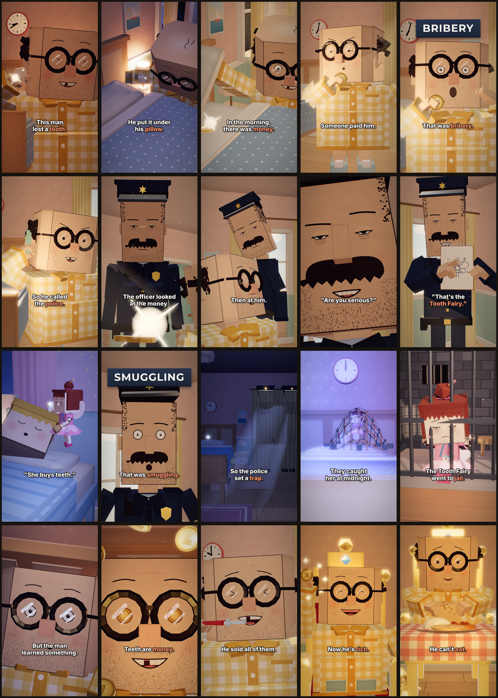

# The Tooth Fairy — 9:16 animated short

A 30-second vertical (1080×1920, 30 fps) low-poly papercraft cartoon, built in
code with Three.js and rendered frame by frame in headless Chromium. Every
cut, caption and label card is synced to the provided voiceover
(`assets/voiceover.mp3`). No other voices or narration are added. The only
other sounds are soft synthesized effects: coin clinks, a distant siren and a
net swoosh.

**Final video:** [`tooth_fairy_short.mp4`](tooth_fairy_short.mp4)

**Stills:** full-resolution (1080×1920) key frames of all 20 scenes are in [`stills/`](stills/), and [`stills/storyboard.jpg`](stills/storyboard.jpg) shows them on one sheet.



## Timing sheet

Scene cuts land 1–2 frames before each spoken line. The timings come from
`tools/analyze_audio.py`, which uses energy-based segmentation plus
PocketSphinx forced alignment, and are stored in `assets/timing.json`.

| # | Cut (s) | Line | Coral keyword | On screen |
|---|--------:|------|---------------|-----------|
| 1 | 0.00 | This man lost a tooth. | tooth | holds up the tiny tooth, gap-tooth grin (punch-in on "tooth") |
| 2 | 1.63 | He put it under his pillow. | pillow | night, slides the tooth under the fluffy pillow |
| 3 | 3.13 | In the morning, there was money. | money | morning light, lifts pillow, shiny coin + clink (punch-in on "money") |
| 4 | 4.97 | Someone paid him. | – | eyes dart around the room, suspicious |
| 5 | 6.20 | That was bribery. | bribery | **BRIBERY** card lands on the word (6.58 s), he gasps |
| 6 | 7.40 | So he called the police. | police | old brick phone at his ear, serious face, lip-sync |
| 7 | 8.93 | The officer looked at the money. | – | low angle past the coin up at the bored officer |
| 8 | 10.50 | Then at him. | – | slow head turn to the man |
| 9 | 11.83 | "Are you serious?" | – | snap zoom on the officer's tired face, lip-sync |
| 10 | 13.10 | "That's the Tooth Fairy." | Tooth Fairy | points at a fairy sketch on his notepad |
| 11 | 14.50 | "She buys teeth." | – | cutaway: fairy with a tooth by a sleeping kid, yawns |
| 12 | 16.03 | That was smuggling. | smuggling | **SMUGGLING** card lands on the word (16.43 s), eyes go wide |
| 13 | 17.23 | So the police set a trap. | trap | night: officers in the wardrobe, under the bed, behind the curtains; tooth bait |
| 14 | 19.07 | They caught her at midnight. | – | net drops on the fairy (swoosh), red/blue lights, siren, clock at 12 |
| 15 | 20.43 | The Tooth Fairy went to jail. | jail | tiny jail cell on a police desk, wings drooping |
| 16 | 22.10 | But the man learned something. | – | lying in bed, staring at the ceiling, idea |
| 17 | 23.60 | Teeth are money. | money | eyes close-up, coins orbit his head, pupils turn to coins |
| 18 | 25.03 | He sold all of them. | – | montage: pliers pop (cartoon, no blood) → teeth into a sack |
| 19 | 26.33 | Now he's rich. | rich | golden throne, coin piles, toothless grin |
| 20 | 27.53 | He can't eat. | eat | gums a chapati at a big plate of food; hold ~1 s |
| – | 29.43 | — | – | cut to black (ends at 30.0 s) |

## Build

Requirements: Node 18+, Chromium via Playwright, ffmpeg, and Python 3 with
numpy.

```bash
npm install
bash tools/build.sh          # render 900 frames -> mix audio -> tooth_fairy_short.mp4
```

Quick preview at a quarter of the resolution:

```bash
node tools/render.mjs --out build/preview --scale 0.25 --workers 4 --qs shadow=1024
```

To regenerate `assets/timing.json`:

```bash
pip install pocketsphinx numpy
python3 tools/analyze_audio.py assets/voiceover.mp3 assets/timing.json
```

## Layout

- `src/timeline.js` — cut frames, captions, keyword highlights, cue times
- `src/shots.js` — the 20 scenes, each a pure function of time (deterministic, so frames can render in parallel)
- `src/characters.js` — blocky rigs (man, officer, fairy, kids) with two-bone arm IK
- `src/faces.js` — hand-drawn ink faces on canvas (eyes, brows, lip-sync mouths)
- `src/sets.js`, `src/props.js`, `src/materials.js`, `src/tex.js` — papercraft sets, props and procedural paper textures
- `src/post.js` — bloom, filmic tone map, warm grade, vignette, film grain
- `src/overlay.js` — captions and the BRIBERY/SMUGGLING label cards
- `tools/render.mjs` — headless renderer (Playwright + SwiftShader WebGL)
- `tools/sfx.py` — synthesized SFX mixed under the untouched voiceover
